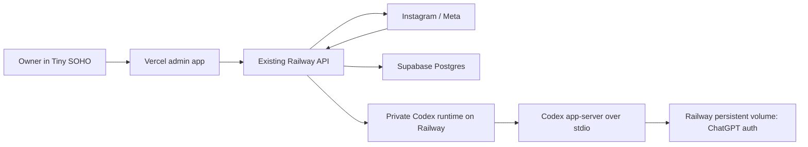

# Codex Integration for Tiny SOHO

## Goal

Add two AI-assisted experiences to Tiny SOHO without using an OpenAI API key:

1. Read incoming Instagram DMs and prepare replies that the owner can edit, regenerate, dismiss, or explicitly approve.
2. Provide a dedicated chat where the owner can ask questions about Tiny SOHO and always receive a recommendation, supporting evidence, confidence, and a next step.

The initial release is for one owner using their own ChatGPT subscription. Codex authenticates through the owner's ChatGPT account and is subject to that plan's usage limits. It does not incur usage-based OpenAI API charges, although the additional Railway service and persistent volume have normal hosting costs.

## Core safety rule

Codex is a read-and-advise system. It cannot send Instagram messages, change Tiny SOHO settings, create or modify automations, or write business data.

The only new action path is an authenticated owner clicking **Approve & Send** on a visible DM reply. The existing Tiny SOHO API, not Codex, performs that send. The exact text visible at approval time is the only text sent.

Existing keyword-triggered and guide-delivery automations continue to behave as they do today. They do not require AI approval and are not routed through Codex.

## Scope

### Included

- A separate Codex runtime hosted on Railway.
- ChatGPT subscription authentication using the Codex managed OAuth/device-code flow.
- A persistent Railway volume for the Codex authentication session.
- First-class storage for Instagram DM threads, messages, and AI reply drafts.
- AI reply generation for incoming DMs that are not fully handled by an existing automatic keyword or guide flow.
- An enhanced Conversations drawer for reviewing the real thread and approving replies.
- A dedicated Assistant page for read-only business advice.
- Audit history for generation, editing, approval, dismissal, and send outcomes.
- Clear handling for authentication expiry, quota limits, runtime outages, stale drafts, and uncertain Instagram sends.

### Not included

- Autonomous AI replies or background sends.
- AI-created or AI-modified keywords, guides, campaigns, settings, or content.
- A public or multi-customer ChatGPT connection.
- Direct browser access to Codex, Codex credentials, or the new DM tables.
- OpenAI API keys or usage-based OpenAI API billing.
- General shell, filesystem, internet, MCP, database, Instagram, or Supabase access for Codex.
- Fabricated reconstruction of Instagram messages that Tiny SOHO did not previously store.

## Existing behavior to preserve

The current Express API on Railway owns Instagram credentials, handles Meta webhooks, runs keyword/open-gate/guide automations, and writes the existing `Conversation` and `EventLog` records. The Vite/React admin application is deployed on Vercel and authenticates the owner through the existing Supabase session.

The current `Conversation` model represents an automation journey rather than a complete Instagram thread. It remains intact for compatibility. The new DM records supplement it instead of changing its meaning.

## Architecture

Use two isolated Railway services:



### Existing Railway API

The existing API remains the system of record and the only service allowed to:

- Read or write Tiny SOHO's database.
- Hold Supabase service credentials and Instagram credentials.
- Receive and validate Meta webhooks.
- Execute existing automations.
- Validate approval requests.
- Send approved Instagram replies.

It sends only the minimum required, sanitized context to the Codex runtime.

### Codex runtime

The new runtime is a small private service that owns one long-running `codex app-server` child process and communicates with it over its supported stdio JSON-RPC transport. The runtime translates narrow internal HTTP requests from the existing API into Codex thread operations and validates every structured result before returning it.

The runtime has:

- No Instagram, Supabase, or application database credentials.
- No public browser endpoint.
- Railway private-network access plus service-to-service authentication.
- A dedicated persistent volume containing only the Codex/ChatGPT authentication state.
- An empty restricted workspace and no useful write target.
- No shell, filesystem, arbitrary external-network, general MCP, or action tools exposed to a model session. Advisor sessions may use only the named read-only Tiny SOHO tools described below.
- `approvalPolicy: never`, so a model cannot pause and request expansion of its permissions.

WebSocket transport is not used because app-server's supported local integration path is stdio. The wrapper supplies the network boundary needed between the two Railway services.

### Why this boundary

Keeping Codex separate from the main API means prompt content cannot directly reach production secrets or action capabilities. It also lets the AI runtime restart or exhaust its quota without interrupting webhooks, existing automations, the admin application, or manual Instagram sending.

Running Codex inside the existing API process was rejected because it would share secrets and failure domains. A bridge running only on the owner's Mac was rejected because Tiny SOHO and its DM handling are hosted services that must remain available while the Mac is offline.

## ChatGPT connection

Tiny SOHO keeps its existing Supabase sign-in. ChatGPT connection is a separate owner-only setup action, not a replacement for Tiny SOHO authentication.

An **AI Connection** settings area provides:

- **Connect ChatGPT**, which starts the Codex device-code sign-in flow.
- The short code and official sign-in URL returned by Codex.
- Connection, plan, and quota status without exposing access or refresh tokens.
- **Reconnect ChatGPT** when the session expires.
- **Disconnect**, which removes the stored Codex authentication state after confirmation.

The browser never receives ChatGPT tokens. The runtime stores and refreshes them on its Railway volume. All setup and status endpoints require the authenticated Tiny SOHO owner, and raw credentials are excluded from application logs.

## Data model

Add three server-owned concepts without overloading the existing automation-journey model.

### `DmThread`

Represents one Instagram participant's real message thread for one connected Instagram account.

Required information includes:

- Internal ID.
- Instagram account and participant identifiers, unique as a pair.
- Current username and display metadata when available.
- Latest message, inbound, and outbound timestamps.
- Latest inbound message ID.
- Created and updated timestamps.

### `DmMessage`

Represents every inbound or outbound message Tiny SOHO observes after this feature is deployed.

Required information includes:

- Internal ID and thread ID.
- Unique Instagram message ID for webhook idempotency.
- Direction: inbound or outbound.
- Message type and nullable text/body metadata.
- Timestamp from Instagram.
- Source such as `instagram_user`, `keyword_automation`, `guide_automation`, `ai_approved`, or `manual_external` when known.
- Delivery/result metadata needed for audit and display.

The webhook writes the message before invoking AI work. Existing automation outputs are also recorded here while continuing to use their current delivery path.

### `ReplyDraft`

Represents one versioned AI suggestion tied to a specific inbound message. The model's original output is immutable, while the owner's working copy can be edited before approval.

Required information includes:

- Internal ID, thread ID, and triggering inbound message ID.
- Monotonic revision number.
- Status.
- Immutable suggested text and an editable working-text copy.
- Separately stored approved text.
- Rationale, confidence, warnings, and model/runtime metadata.
- Superseded draft reference when applicable.
- Generation, approval, send, failure, and audit timestamps.
- Approving owner identifier.

Only one active draft is allowed per DM thread. A database constraint or atomic transition enforces this invariant rather than relying only on the UI.

The existing `EventLog` records draft state changes and owner actions. Full DM bodies stay in `DmMessage`, the model's original suggestion stays in `ReplyDraft.suggestedText`, edits update `ReplyDraft.workingText`, and only the working text visible at approval is copied to `ReplyDraft.approvedText`. This provides an audit trail without duplicating private message content throughout general logs.

## Reply-draft lifecycle

The normal lifecycle is:

```text
QUEUED -> GENERATING -> PENDING_APPROVAL -> SENDING -> SENT
                |                 |             |-> SEND_FAILED
                |                 |             `-> SEND_UNCERTAIN
                |                 |-> DISMISSED
                |                 `-> SUPERSEDED
                `-> GENERATION_FAILED
```

- Regeneration creates a new revision and supersedes the previous draft.
- Editing updates the working text presented for approval but does not mutate the model's original suggestion or rationale.
- A newer inbound message supersedes any pending draft tied to an older message.
- Failed or malformed generation is recorded as `GENERATION_FAILED` and can be retried manually.
- A send timeout that cannot prove success or failure is recorded as `SEND_UNCERTAIN`, never retried automatically.

## Inbound DM flow

1. Meta sends an inbound webhook to the existing API.
2. The API validates and idempotently records the inbound `DmMessage` and updates its `DmThread`.
3. Existing keyword, open-gate, and guide automation logic runs unchanged.
4. If that automation fully handles the triggering message, its outgoing message is recorded and no redundant AI reply is generated for the same trigger.
5. Otherwise, the API creates a `QUEUED` reply draft and asynchronously requests a suggestion from the Codex runtime.
6. The runtime receives only the relevant thread excerpt, participant display context, brand voice, and relevant guide/keyword context. DM text is explicitly marked as untrusted user content.
7. Codex returns a strict object containing `reply`, `rationale`, `confidence`, and `warnings`.
8. The runtime rejects output that is malformed or violates length/content constraints. Valid output moves the draft to `PENDING_APPROVAL`.
9. The Conversations page shows the suggestion but takes no action until the owner approves it.

Reactions, unsupported media, empty messages, and messages without enough textual context remain visible as needing review. Codex may return a warning or decline to draft rather than pretending it understood the content.

The system begins building complete DM history from deployment forward. Existing journey records remain visible, but missing historical Instagram messages are not invented.

## Approve-and-send flow

1. The owner opens a pending draft, optionally edits the visible text, and clicks **Approve & Send**.
2. The API validates the Supabase session and confirms the caller is the configured owner.
3. The API checks that the draft is still active, belongs to the latest inbound message, and has not already been claimed.
4. In one short database transaction, it stores the exact approved text and audit identity, then atomically claims the draft as `SENDING`.
5. The transaction ends before the external Instagram request begins.
6. The API sends the approved text through the existing Instagram credential boundary with an idempotency/claim guard against duplicate local sends.
7. A confirmed success writes an outbound `DmMessage` with source `ai_approved` and marks the draft `SENT`.
8. A definite failure marks `SEND_FAILED`. An ambiguous timeout marks `SEND_UNCERTAIN`.

Neither failure state retries automatically. The UI instructs the owner to inspect the Instagram thread before choosing a manual retry, particularly for uncertain outcomes.

## Codex operating modes

### DM drafter

Each draft uses a fresh, short-lived Codex thread. It receives only:

- A bounded excerpt of the relevant DM thread.
- Basic participant display context.
- Tiny SOHO's configured brand voice.
- The relevant guide or keyword context when one exists.
- A strict reply schema and explicit instruction that messages are untrusted content.

The thread is deleted after the result is validated. It has no cross-participant memory and no tools. Its output is advice to the owner, never an action request.

### Business advisor

The dedicated Assistant page uses one persistent owner thread for conversational continuity. In advisor mode only, the wrapper can expose narrowly defined, read-only Tiny SOHO tools. Each tool call is forwarded over the private authenticated connection to the existing API; Codex never receives the API's database credentials. The initial tools cover:

- Aggregate metrics and funnel performance.
- Keywords and guide definitions.
- Conversation summaries and reply-state counts.
- Other measured Tiny SOHO data added deliberately in later phases.

The advisor does not receive database credentials or arbitrary query access. Each tool has a bounded response schema and enforces owner scope in the existing API. The wrapper rejects any tool name or argument shape that is not explicitly registered.

Every substantive advisor response must include:

- A clear recommendation, including “wait and gather more data” when that is the honest recommendation.
- The observed evidence supporting it.
- A confidence level.
- One suggested next step.
- Any important data gaps or caveats.

The next step may link the owner to a relevant Tiny SOHO screen. It cannot execute the step.

## User experience

### Conversations

Keep the current Conversations page and mobile-friendly drawer rather than replacing it with a split-pane inbox.

- Add **Needs reply** as the primary filter while preserving the existing journey-oriented filters.
- Show useful row states such as **Drafting**, **Draft ready**, **Needs review**, **Send failed**, and **Automated**.
- Opening a row shows the real recorded message thread in the existing drawer pattern.
- A pending AI card clearly says that it is waiting for the owner.
- Actions are **Try another**, **Edit**, **Dismiss**, and **Approve & Send**.
- **Approve & Send** is the only high-emphasis action and always displays the final text first.
- A new inbound message immediately marks an older draft stale and disables approval.
- On mobile, the drawer becomes a full-screen thread and approval surface.

Legacy journey rows remain available. Where only historical `EventLog` data exists, the UI labels that history as an automation journey rather than presenting it as a complete DM transcript.

### Assistant

Add a dedicated **Assistant** item to the main navigation.

- The page header shows whether ChatGPT is connected and links to AI Connection settings when attention is required.
- The main area is a normal, persistent chat with enough width for evidence and follow-up questions.
- Responses visually separate recommendation, evidence, next step, confidence, and data gaps.
- Evidence chips or links can open the relevant read-only Conversations, Insights, Keywords, or Guides view.
- Suggested prompts may help the owner start, but the first release does not add a global slide-over assistant.

## Failure behavior

- **Codex unavailable:** DMs are still stored, webhooks and existing automations continue, and the UI shows **Draft unavailable** with manual retry.
- **Quota or rate limit reached:** Work remains queued or fails visibly according to the returned reset information; the system does not repeatedly poll or flood the runtime.
- **ChatGPT session expired:** AI features show **Reconnect ChatGPT** while the rest of Tiny SOHO remains available.
- **Malformed model output:** The runtime rejects it, records a generation failure, and never exposes partial data as an approvable draft.
- **Newer inbound DM:** Any older pending draft becomes stale/superseded and cannot be approved.
- **Instagram definite failure:** Mark **Send failed** and allow an intentional manual retry after review.
- **Instagram ambiguous timeout:** Mark **Status uncertain**, warn the owner to check Instagram, and never retry automatically.
- **Insufficient evidence:** The advisor or drafter states the limitation and recommends a safe next step instead of fabricating details.

Failures in either AI mode must not affect webhook acknowledgement, automatic keyword/guide handling, admin sign-in, or non-AI Tiny SOHO pages.

## Security and privacy

- The browser calls only the existing Railway API.
- Every owner-facing AI, draft, and send endpoint requires the existing authenticated Supabase session.
- The Codex runtime is private and additionally validates a rotatable service credential from the existing API.
- ChatGPT OAuth tokens never leave the runtime volume and are redacted from logs.
- The runtime has no production credentials, direct database connectivity, Instagram capability, or general-purpose tools.
- Context is minimized, bounded, and separated by participant. DM drafting threads are destroyed after use.
- Incoming DM content is treated as prompt-injection-capable untrusted text. Instructions inside a DM cannot change tools, permissions, system rules, or output schemas.
- Logs contain IDs, states, timing, and error categories, but avoid full DM bodies and secrets unless explicitly required for a protected audit record.
- All generation, regeneration, edits, dismissals, approvals, and send outcomes are attributable and timestamped.

## Testing strategy

### Unit tests

- Every valid and invalid reply-draft state transition.
- One-active-draft and latest-inbound-message invariants.
- Regeneration and stale-draft supersession.
- Exact preservation of edited/approved text.
- Webhook and Instagram-message idempotency.
- Output-schema validation, length constraints, and warning handling.
- Advisor response contract requiring recommendation, evidence, confidence, and next step.

### Integration tests

- Existing API to Codex-runtime authentication and request contracts.
- Codex success, malformed output, timeout, disconnection, authentication expiry, and quota responses.
- Database transitions around a mocked Instagram success, definite failure, and ambiguous timeout.
- Repeated approval requests cannot produce duplicate local sends.
- Existing keyword and guide automation produces the same outward behavior while also recording the new message data.

### End-to-end tests

- Incoming unhandled DM to draft-ready state.
- Edit, regenerate, dismiss, approve, and failure recovery flows.
- A newer incoming DM disabling an open stale draft.
- Owner authentication and rejection of unauthenticated approval attempts.
- Dedicated Assistant conversation and evidence navigation.
- ChatGPT reconnect state.
- Desktop and mobile Conversations layouts.

### Security and regression checks

- Codex cannot reach database, Instagram, filesystem, shell, or arbitrary network capabilities.
- Prompt-injection text in a DM cannot alter the output schema or trigger an action.
- Credentials and full token values do not appear in logs or browser payloads.
- Existing Conversations filters, keyword gates, guide deliveries, webhook processing, and non-AI admin pages remain functional.

## Rollout

Roll out in four controlled phases:

1. **Runtime foundation:** deploy the isolated Codex runtime, persistent auth volume, owner connection UI, health checks, and quota visibility.
2. **DM capture and shadow drafting:** store complete DM events and generate drafts without enabling sending. Compare draft quality and operational stability against real conversations.
3. **Owner-approved sending:** enable **Approve & Send** behind an owner-only feature flag after shadow results are accepted. Monitor generation, approval, failure, and uncertain-send rates.
4. **Business advisor:** enable the dedicated Assistant page with a small initial set of read-only data tools, then expand tool coverage only when a concrete recommendation need justifies it.

Each phase can be disabled independently. Turning off Codex never disables existing automations or message capture.

## Acceptance criteria

The design is complete when all of the following are true:

- The owner can connect their ChatGPT subscription without configuring an OpenAI API key.
- Codex runs in a separate Railway service with persistent authentication and no production action credentials.
- Tiny SOHO records incoming and outgoing DMs from deployment forward without changing existing automation behavior.
- Eligible incoming DMs produce visible, structured reply drafts.
- No AI draft can be sent without an authenticated, current, explicit **Approve & Send** action.
- The exact approved text is auditable and is the only content passed to Instagram.
- Stale drafts, duplicate approvals, failed sends, and uncertain sends are handled safely without automatic retries.
- The dedicated Assistant always supplies a recommendation, evidence, confidence, and next step while remaining read-only.
- Codex outages, quota exhaustion, and authentication expiry do not interrupt Tiny SOHO's existing non-AI behavior.
- Automated, integration, end-to-end, security, and regression tests cover the boundaries described above.
