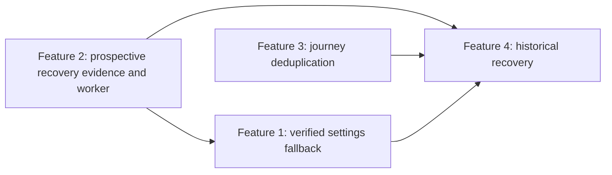
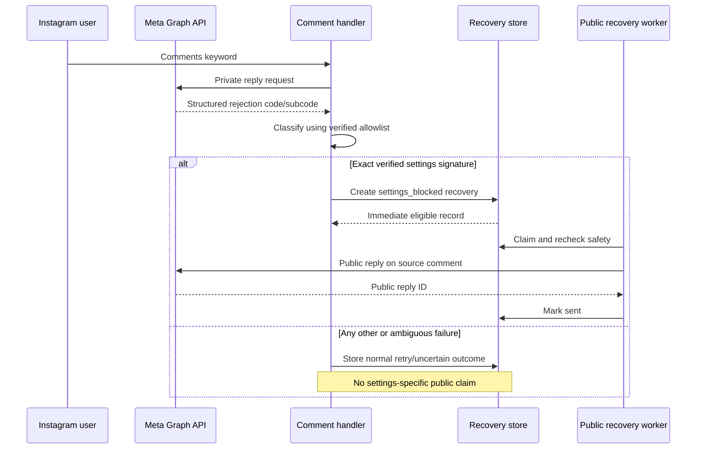
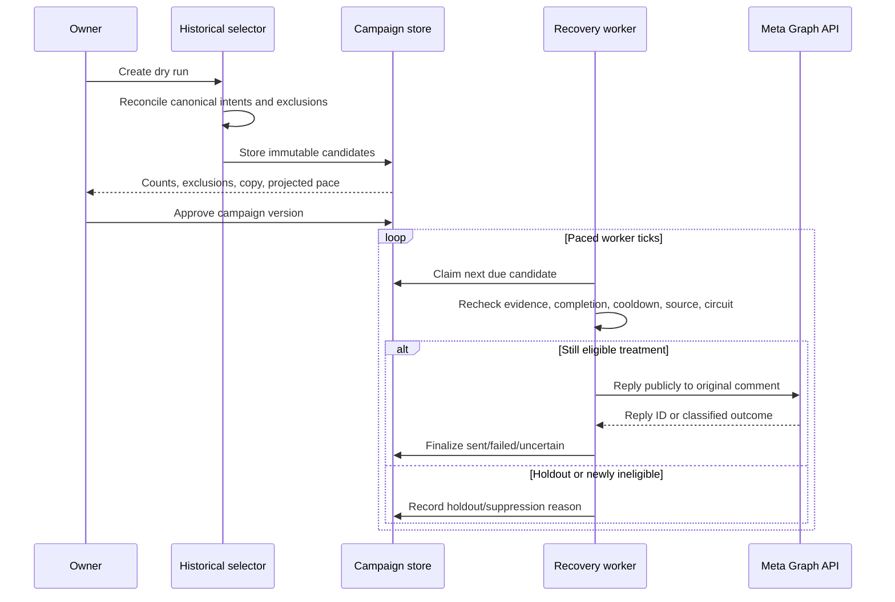

# Instagram Automation Feature Requests 1, 3, and 4

> **Historical context.** The prospective ten-hour workflow mentioned here is
> `read-recovery-v1`; new prospective enrollment uses the v2 timing experiment.

## 1. Purpose

This document defines the three remaining Instagram automation feature requests discussed during
the read-recovery investigation:

1. **Feature Request 1 — Explicit message-settings failure fallback**
2. **Feature Request 3 — Journey deduplication and reconciliation**
3. **Feature Request 4 — Historical recovery and controlled backfill**

Feature Request 2—the prospective ten-hour no-confirmed-read recovery workflow—is intentionally
not specified here because it is already being built and audited separately.

This document is a product and engineering design, not an implementation plan. It defines the
problem, intended behavior, safety boundaries, data flow, owner experience, measurement, rollout,
and acceptance criteria for each feature. Each feature should receive its own implementation plan
after this design is approved.

## 2. Context

The current automation begins when somebody comments a configured keyword such as `PROTEIN`,
`SLEEP`, or `POTTY` on an Instagram post. The system replies publicly, attempts a private gate DM,
waits for the person to follow and reply `DONE`, and then delivers the guide.

The investigation found three distinct problems beyond the prospective read-recovery feature:

- Meta can explicitly reject a private reply because the recipient cannot receive new message
  requests. The user receives nothing unless the automation explains what to do publicly.
- One person can create multiple automation journeys for the same keyword by commenting again,
  retrying on another post, or triggering duplicate/parallel flows. This inflates `No reply` counts
  and can send repetitive DMs.
- Thousands of historical journeys predate reliable read tracking. Some are confirmed delivery
  failures; others have unknown read status. They need a conservative, auditable recovery strategy
  rather than a bulk blast.

These are separate failure modes and must remain separately measurable. A settings rejection is
not the same as a DM accepted without later engagement. A duplicate journey is not a new person.
Historical uncertainty is not proof that somebody failed to read a message.

## 3. Recommended delivery order

The recommended order is:

1. **Finish and validate Feature Request 2.** It establishes the prospective evidence model,
   recovery states, public-comment safety controls, dashboard, pacing, cooldown, and accuracy
   metrics.
2. **Finish Feature Request 1.** Its core path may share the Feature 2 recovery worker, but it has a
   different trigger, immediate eligibility, different copy, and a separate classifier audit.
3. **Build Feature Request 3.** Canonical journey identity and reconciliation should exist before
   historical records are selected, or the backfill will count and contact duplicate journeys.
4. **Build Feature Request 4.** Historical recovery is last because it depends on Feature 2's
   measured safety and Feature 3's canonical-person/journey model.

Feature 1 and Feature 3 can be designed in parallel, but Feature 4 must not launch before both
Feature 2 and Feature 3 are production-proven.



## 4. Shared principles

All three features must follow these rules:

1. **Evidence before claims.** The UI and public copy may state only what Meta or the system has
   actually established.
2. **No inferred unread status.** Missing `messaging_seen` means `No confirmed read`, not `Unread`.
3. **At most one public recovery attempt per person within the configured cooldown.** This applies
   across keywords and across prospective/historical recovery.
4. **No blind retry after an ambiguous Meta outcome.** A timeout can mean the request succeeded.
   Ambiguous sends become `send_uncertain` and require reconciliation.
5. **Never delete history.** Duplicate and superseded journeys remain available for audit but stop
   affecting active work and headline metrics.
6. **Unique people and automation journeys are separate metrics.** Neither number substitutes for
   the other.
7. **Every automated decision is explainable.** The dashboard must show the trigger, evidence,
   suppression reason, send outcome, and related canonical journey.
8. **Western-market audience targeting.** @tinysoho is a parenting product sold to a Western
   market, and its automation is scoped to that audience. Public recovery comments are withheld
   from an audience outside that market.

   Meta exposes no per-user country, so the only available signal is a name and username proxy
   (`DM_RECOVERY_WESTERN_ONLY`, see `docs/meta-verification.md`). Its limits are real and must stay
   documented rather than assumed away: it is not geography, it misses diaspora users in the West,
   and roughly 30% of users have no usable name and fall through as `unknown`.

   Two boundaries hold regardless:

   - **Withholding applies only to the unsolicited public comment**, never to the guide. Anyone who
     asks receives the gate DM and, on completing the journey, the guide. The market filter decides
     only whether the account posts a public reminder to someone who has gone quiet.
   - **No other trait may gate eligibility.** Religion, caste, and language are not targeting
     inputs. Where a directly supplied or account-level market signal becomes available, it should
     replace the name proxy.
9. **Kill switches preserve evidence.** Disabling outbound recovery stops new public comments but
   continues safe ingestion and keeps pending records intact.
10. **Source comments must still exist.** The automation never redirects a reminder onto a
    different comment or post merely because the original is unavailable.

---

# Feature Request 1 — Explicit Message-Settings Failure Fallback

## 5. Problem statement

In some comment-origin private-reply attempts, Meta explicitly rejects the DM because the recipient
does not allow new message requests. Instagram Business Suite may later display a gray warning, but
that UI warning is not available to the automation as a webhook or queryable API event.

When the Graph API itself returns a verified structured settings rejection, the system knows the
gate DM was not delivered. Without a public fallback, the person reasonably believes the automation
ignored their keyword comment.

The feature must react only to a verified API rejection. It must not post the fallback to every
commenter, infer the condition from lack of reply, scrape Business Suite, or classify by provider
error-message text.

## 6. User story

> As a person who requested a guide but whose Instagram settings rejected the DM, I want a concise
> public explanation and a simple recovery action so I can still receive the guide.

Owner story:

> As the account owner, I want the settings fallback to run only when Meta explicitly proves that
> condition, so ordinary commenters do not receive a confusing or spammy public reply.

## 7. Approved public copy

The public fallback is:

> I couldn’t send your DM 💛 Your message-request settings blocked it. DM @tinysoho “{KEYWORD}”.

Rules:

- `{KEYWORD}` is the snapshotted keyword from the triggering journey, displayed in uppercase.
- The copy is stored with the recovery record at creation time. Later keyword edits do not change
  an already-created fallback.
- The system must not substitute a guide name, username, or free-form provider error.
- The settings claim is allowed only for a verified settings signature.

## 8. Trigger contract

Feature 1 triggers only when all conditions are true:

1. The source is a comment-origin keyword journey.
2. The private gate request reached Meta and Meta returned a structured rejection.
3. The normalized numeric `graphCode:graphSubcode` pair is in the explicitly configured
   `DM_RECOVERY_SETTINGS_BLOCKED_SIGNATURES` allowlist.
4. The signature was previously verified with a controlled test account and documented.
5. The source comment ID is available.
6. The same comment has not already created or completed the fallback.
7. No positive evidence shows the person already received/completed an equivalent journey.
8. The person is not inside the public-recovery cooldown.
9. The outbound kill switch and persistent circuit allow the attempt.

Feature 1 does not trigger when:

- Meta accepted the private reply, even if Business Suite later shows a gray warning;
- the person did not reply or no read receipt arrived;
- the request timed out, reset, or returned an ambiguous success;
- the failure is rate limiting, auth, permission, deleted comment, expired comment, already-replied
  comment, or another invalid-comment family;
- the classifier recognizes only text such as `can't receive your message` without an allowlisted
  numeric signature;
- the source is a normal inbound DM rather than a keyword comment.

## 9. Signature verification process

The allowlist begins empty. Adding a signature requires this evidence package:

1. Use a controlled Instagram account configured not to receive new message requests.
2. Comment a unique test keyword on a test post.
3. Confirm the private-reply request was rejected rather than accepted.
4. Record only HTTP status, numeric Graph code, numeric subcode, and safe request trace ID.
5. Repeat the test to confirm the pair is stable.
6. Run a negative control with message requests enabled.
7. Confirm the pair is not shared by rate limits, expired/deleted comments, already-replied
   comments, or permissions problems.
8. Document the test date, Meta app/account, expected outcome, and redacted evidence.
9. Add the exact pair to the environment allowlist.
10. Audit the first production match before increasing volume.

`100:2534025` must not be treated as a verified settings signature. It belongs to a broader
invalid-comment family and cannot safely justify telling a person their settings caused the issue.

## 10. Data flow



## 11. State model

The settings fallback uses a dedicated trigger kind: `settings_blocked`.

Recommended states:

- `waiting`: verified settings record exists and is eligible immediately;
- `sending`: one worker owns a leased attempt;
- `sent`: Meta returned a nonempty public reply ID;
- `send_failed`: Meta definitely rejected the public comment permanently;
- `send_uncertain`: public outcome may have succeeded; never retry automatically;
- `suppressed`: evidence/cooldown/completion/source checks made the fallback unnecessary or unsafe;
- `cancelled`: owner stopped it before a public comment;
- `control` is not used for settings failures because the failure is known and excluded from the
  no-confirmed-read experiment.

## 12. Idempotency and concurrency

- The Meta comment ID is unique for Feature 1 recovery creation.
- Exact comment webhook replays must be reserved before the private call and must not create a
  second conversation, DM, or fallback.
- A gate-queue retry that later receives the same verified rejection converges on the same recovery
  record.
- Only one `sending` public recovery may exist per person.
- Conditional finalizers update only the row holding the valid lease.
- A worker crash after public dispatch becomes uncertain when the lease expires.
- A second webhook, worker, or owner action cannot turn an uncertain outcome into an automatic
  second public comment.

## 13. Dashboard experience

The owner sees:

- trigger: `Settings blocked`;
- evidence: verified numeric signature and verification version, never raw provider text;
- original keyword, post, comment, and person;
- immediate eligibility timestamp;
- suppression/cooldown reason if not sent;
- public reply ID and timestamp when confirmed;
- `Send outcome uncertain—check Instagram` for ambiguous outcomes;
- cancel before send and mark-reviewed for attention states;
- no manual `Send now` override.

The detail explanation should say:

> Meta rejected the gate DM with a verified message-settings signature, so the public fallback was
> eligible immediately.

## 14. Metrics

Track Feature 1 separately from Feature 2:

- verified settings matches;
- unique people and journey records;
- fallback eligible, sent, failed, uncertain, suppressed, and cancelled;
- public fallback to inbound-DM conversion within 24 and 48 hours;
- inbound keyword match after fallback;
- final guide completion within 24 and 48 hours;
- duplicate create attempts;
- cooldown suppressions;
- classifier signature breakdown;
- false-classification reports found during owner audit.

These records are excluded from the Feature 2 treatment/control experiment because their gate DM
was definitively rejected rather than accepted.

## 15. Alternatives considered

### A. Post fallback to every commenter

Rejected. It is spammy, confusing, and makes a settings claim without evidence.

### B. Wait for Business Suite's gray warning

Rejected. The warning is not exposed as an API event and cannot be reliably polled.

### C. Verified structured-error allowlist

Recommended. It is narrow, auditable, disabled by default, and makes the public claim only when the
provider's structured response has been verified.

## 16. Acceptance criteria

Feature 1 is complete only when:

- the allowlist defaults empty;
- one controlled settings signature is verified or the production feature remains inert;
- no message-text matching exists;
- rate limit/auth/invalid/ambiguous failures cannot enter the settings path;
- exact copy is snapshotted and tested;
- duplicate/replayed comment and queue paths create at most one fallback;
- the same person receives at most one public recovery inside cooldown;
- missing source, completion, positive evidence, cancellation, and circuit state suppress safely;
- confirmed public success requires a nonempty reply ID;
- ambiguous public outcomes are never retried automatically;
- dashboard states and metrics are distinct from no-confirmed-read recovery;
- a controlled end-to-end Meta test records the expected public comment and recovery DM.

---

# Feature Request 3 — Journey Deduplication and Reconciliation

## 17. Problem statement

The historical analysis found 247 expired journeys belonging to somebody who completed the same
keyword in another journey. In 215 cases the successful journey opened later, 189 of those opened
within 48 hours, and the median gap was approximately six minutes.

This strongly suggests repeated comments, retries, or parallel triggers created multiple journey
records for one person's single intent. Exact duplicate webhook idempotency solves the same Meta
comment being delivered twice, but it does not solve two different comments from the same person
for the same keyword.

Consequences today include:

- duplicate gate DMs and public acknowledgements;
- multiple active timers for the same requested guide;
- completed people still appearing under `No confirmed reply` in another row;
- inflated automation-journey counts;
- confusing owner timelines;
- historical recovery selecting the same person more than once.

## 18. User story

> As a person asking for the same guide more than once, I want the automation to continue one
> coherent request rather than restarting and sending repetitive messages.

Owner story:

> As the account owner, I want one canonical journey per person and keyword intent, while preserving
> every trigger for audit, so unique-person conversion and automation reliability are both accurate.

## 19. Definitions

- **Person:** stable Instagram-scoped user ID, not username or display name.
- **Keyword identity:** configured keyword ID. A renamed keyword keeps the same identity; two
  different keyword records are not merged merely because their text matches.
- **Trigger:** one distinct source event, normally a Meta comment ID, with its media and received
  timestamp.
- **Canonical journey:** the one conversation responsible for current state, messaging, completion,
  and recovery for a person-keyword intent window.
- **Alias/superseded journey:** a historical conversation that points to the canonical journey and
  performs no further automation.
- **Active window:** 48 hours from the canonical journey's most recent qualifying trigger.
- **Recovered journey:** an older incomplete journey whose person/keyword intent completed through
  another canonical journey.

## 20. Canonical identity and 48-hour rule

The deduplication key is:

```text
Instagram user ID + keyword ID
```

Media/post ID is recorded on each trigger but is not part of the canonical identity. If one person
comments `PROTEIN` on two different posts within 48 hours, the behavior should still be one active
PROTEIN request rather than two identical guide funnels.

Rules:

1. If an active canonical journey for the same person/keyword exists and its most recent trigger is
   less than 48 hours old, attach the new trigger to it.
2. At exactly 48 hours, a new journey may be opened. The boundary is strict and tested.
3. A completed canonical journey remains reusable within 48 hours for reconciliation, but no guide
   or gate DM is resent automatically. The new trigger is recorded as `already_completed_recently`.
4. After 48 hours, a new request may open a new canonical journey because the person's intent may
   genuinely be new.
5. Different keyword IDs remain separate journeys, but person-level public-recovery cooldown still
   prevents multiple public reminders.
6. Exact comment ID replay remains handled by the lower-level idempotency guard and does not create
   a second trigger record.

## 21. Behavior by current canonical state

| Canonical state | New same-person/keyword trigger inside 48h | Outbound behavior |
|---|---|---|
| New/open before gate | Attach trigger to canonical journey. | Continue the existing gate attempt; no duplicate request. |
| Gate retry pending | Attach trigger and retain newest source metadata. | Existing retry continues; no second queue row. |
| Waiting for DONE | Attach trigger and refresh last-trigger audit time. | Do not send another identical gate DM. |
| Recovery scheduled | Attach trigger; keep one canonical recovery timer. | Do not create a second recovery reminder. |
| Recovery sending/sent/uncertain | Attach trigger for audit. | Never initiate another public recovery inside cooldown. |
| Completed | Mark trigger as recently completed. | No automatic resend; optionally public acknowledgement can say to check the existing DM only if separately approved. Default is no outbound action. |
| Expired but otherwise reusable | Reopen the canonical journey only if no conflicting send/completion evidence exists. | One controlled retry path, not a parallel journey. |
| Cancelled by owner | Record trigger and keep cancellation until owner-approved reopening policy exists. | No automatic outbound action. |

## 22. Source-comment handling

Every trigger retains its own comment ID, media ID, received time, and acknowledgement outcome.
Canonical journey state must not overwrite this history.

For a later public-recovery feature:

- use the newest still-available eligible source comment attached to the canonical journey;
- never post the same recovery copy on multiple alias comments;
- if no source comment is available, suppress as `source_unavailable`;
- record which trigger comment was chosen and why;
- do not silently move a reply to an unrelated comment or post.

## 23. Concurrency design

Two different comments can arrive almost simultaneously. A read-then-create application check is
not sufficient.

Recommended database boundary:

1. Lock or atomically upsert a person-keyword canonical-intent record.
2. Evaluate the 48-hour boundary inside the transaction using database time.
3. Insert the trigger with unique `commentId`.
4. Either attach to the existing canonical conversation or create one new canonical conversation.
5. Return an action result: `new_journey`, `reused_active`, `already_completed_recently`, or
   `replayed_comment`.
6. Perform any outbound action only after commit and only for `new_journey` or a specifically
   authorized resumed state.

At most one transaction may receive the `new_journey` result for the same person/keyword window.

## 24. Reconciliation of existing journeys

The historical reconciliation job never deletes or rewrites original events. It computes canonical
relationships and summary state.

Recommended process:

1. Group conversations by Instagram user ID and keyword ID.
2. Sort by first trigger time.
3. Partition into intent windows where consecutive qualifying triggers are less than 48 hours
   apart.
4. Select one canonical journey per window using deterministic precedence:
   - completed journey first;
   - otherwise journey with a confirmed accepted gate ID;
   - otherwise earliest created journey.
5. Attach all triggers and alias journeys to the canonical journey.
6. If any journey in the window completed, mark other unfinished journeys `recovered` or
   `superseded_completed` for reporting.
7. If no journey completed, keep one active/expired canonical state and mark the rest `superseded`.
8. Preserve original conversation state fields for audit; expose reconciled state separately.
9. Produce a dry-run report before writing relationships.
10. Make the reconciliation job restartable and idempotent.

## 25. Data model

Recommended additions:

### `journey_intent`

- `id`
- `ig_user_id`
- `keyword_id`
- `canonical_conversation_id`
- `window_started_at`
- `last_trigger_at`
- `window_expires_at`
- `reconciled_state`
- `completed_at`
- `created_at`
- `updated_at`

### `journey_trigger`

- `id`
- `intent_id`
- `conversation_id`
- `comment_id` unique
- `media_id`
- `received_at`
- `trigger_kind`
- `disposition`
- `public_ack_reply_id`
- `created_at`

### Conversation relationship

- `canonical_intent_id`
- `superseded_by_conversation_id` or a relation table
- `reconciliation_reason`
- `reconciled_at`

The exact schema may reuse existing event and conversation tables, but the database must enforce a
single canonical owner for a person-keyword intent window.

## 26. Owner experience

The dashboard shows:

- **Unique people** and **automation journeys** as separate totals;
- a canonical journey badge;
- `Reused active journey`, `Recovered through another journey`, or `Superseded duplicate` labels;
- every triggering comment in a chronological sub-timeline;
- the canonical completion/recovery outcome;
- links from an alias row to the canonical journey;
- no duplicate row in actionable queues unless the owner explicitly selects raw-history mode.

The existing `No confirmed reply` view should default to canonical unresolved intents, not raw
conversation rows. An optional audit toggle can display aliases.

## 27. Metrics

Track:

- unique people by keyword;
- raw triggers;
- raw conversation journeys;
- canonical intents;
- active-journey reuse count;
- exact webhook replay count;
- superseded/recovered journeys;
- duplicate gate DMs prevented;
- duplicate public reminders prevented;
- completion rate by unique person and by canonical intent;
- time from first and most recent trigger to completion;
- new journey created at/after the 48-hour boundary;
- reconciliation conflicts requiring review.

Headline conversion should use unique people or canonical intents. Raw journey counts remain an
operational diagnostic.

## 28. Alternatives considered

### A. Continue allowing every comment to open a journey

Rejected. It preserves implementation simplicity but inflates metrics and repeats automation.

### B. Deduplicate only exact comment IDs

Insufficient. It handles webhook replay but not a person making two distinct comments for one guide.

### C. Canonical person-keyword intent windows

Recommended. It preserves every trigger while providing one operational journey and deterministic
conversion reporting.

## 29. Acceptance criteria

Feature 3 is complete only when:

- exact comment replay remains idempotent;
- two distinct same-person/keyword comments inside 48 hours create one canonical journey;
- comments on different posts still reuse the same keyword intent inside the window;
- different keywords remain separate;
- the exact 48-hour boundary is deterministic;
- concurrent first triggers produce exactly one canonical journey;
- one canonical journey owns gate retry, completion, and recovery state;
- completing any journey reconciles all same-window aliases without deleting history;
- historical reconciliation is dry-run capable, idempotent, and restartable;
- actionable dashboard queues show canonical unresolved intents by default;
- unique-person, canonical-intent, and raw-journey metrics are separate;
- no duplicate gate DM or public recovery comment is produced by an alias trigger.

---

# Feature Request 4 — Historical Recovery and Controlled Backfill

## 30. Problem statement

Historical `No reply` records combine several situations:

- confirmed private-delivery failure;
- Meta accepted a private reply but no read receipt exists;
- the person read the DM but receipts were unavailable;
- the DM went to Requests or Hidden Requests;
- the person saw it and ignored it;
- the person completed through another duplicate journey;
- legacy records lack the identifiers required for read correlation.

Historical data cannot reconstruct read state that Meta never supplied. Feature 4 must therefore
be a controlled recovery program, not an assertion that historical users were unread and not a
single bulk-send button.

The previously estimated candidate groups were:

- approximately **49 confirmed historical delivery failures** suitable for the safest first phase;
- approximately **1,439 historical users with unknown read status** potentially suitable for a
  later measured pilot.

These numbers are snapshot estimates. Launch selection must recompute exact unique-person counts
after Feature 3 reconciliation.

## 31. User story

> As a person whose earlier guide request genuinely failed or was never visible, I want one clear,
> non-accusatory way to recover the guide without receiving repetitive public comments.

Owner story:

> As the account owner, I want to recover historical missed opportunities conservatively, beginning
> with known failures and expanding only when measured evidence shows the reminder is helpful and
> not spammy.

## 32. Dependencies and launch gates

Feature 4 remains disabled until all gates pass:

1. Feature 2 has run prospectively long enough to measure treatment/control conversion, delayed
   signals, uncertain outcomes, complaints, and public-send accuracy.
2. Feature 3 has reconciled duplicate journeys and exposes canonical intents.
3. Feature 1's verified settings path is separate from generic delivery failure.
4. Public recovery pacing, person cooldown, source validation, uncertain-send handling, dashboard,
   owner cancellation, and circuit breaker are production-proven.
5. The historical selector produces a reviewed dry-run export.
6. The owner explicitly approves each rollout phase and its cap.

## 33. Cohorts

### Phase 1 — Confirmed historical delivery failures

Start with canonical intents where evidence establishes that the private gate did not deliver and
no later journey resolved the request.

Recommended candidate copy:

> I couldn’t send your guide by DM 💛 Please DM @tinysoho “{KEYWORD}” and I’ll send it there.

This copy does not claim recipient settings caused the failure unless the record has Feature 1's
verified settings signature.

For a verified historical settings rejection, Feature 1's exact settings copy may be used instead.

### Phase 2 — Unknown-read pilot

Only after Phase 1 and prospective Feature 2 metrics are acceptable, select a small randomized
sample of canonical historical intents where Meta accepted the gate but read status is unknown.

Recommended copy:

> I sent your guide 💛 Check your DMs/Requests. If you don’t see it, DM @tinysoho “{KEYWORD}”.

The dashboard label is `Historical—no confirmed read`, never `Unread`.

The approximately 1,439-person group is an upper-bound candidate pool, not the first batch. The
recommended pilot begins with the lower of 25 people or 2% of the eligible unique-person pool, with
a matched holdout group.

## 34. Eligibility contract

A historical canonical intent is eligible only when all applicable checks pass:

- comment-origin keyword request;
- one canonical person-keyword intent after Feature 3 reconciliation;
- original source comment still has a valid Meta comment ID;
- no completed journey for the same person/keyword during or after the historical window;
- no inbound reply, quick reply, attachment, reaction, postback, or seen evidence;
- no confirmed public recovery already sent;
- no uncertain public attempt requiring manual review;
- no person-level public recovery inside cooldown;
- no newer active journey that should own the request;
- no owner cancellation, blocklist, complaint, or opt-out;
- guide/keyword still active and safe to deliver;
- age falls within the owner-approved campaign range;
- candidate is inside the approved rollout cohort and cap;
- source comment availability is rechecked immediately before send.

For Phase 1, the record must additionally contain a definitive gate-delivery failure category.

For Phase 2, the record must contain evidence Meta accepted the gate or a documented legacy
accepted state. Records without an accepted message ID are labeled tracking unavailable and are not
automatically included in the unknown-read pilot.

## 35. Exclusions

Never enroll:

- somebody with any positive read/engagement/completion evidence;
- an alias/superseded journey when its canonical intent is already represented;
- a user who later completed the same keyword;
- a DM-origin conversation;
- a missing/deleted/unresolvable source comment;
- a record whose only basis is the Business Suite gray warning;
- a high-confidence out-of-market audience verdict, when `DM_RECOVERY_WESTERN_ONLY` is on — the same
  Western-market filter the prospective feature applies (§4.8). Historical campaigns must apply it
  at selection AND recheck it before send, since a verdict is retired when the name it came from
  changes;
- a record with an ambiguous prior public-send outcome;
- a person who received another recovery inside cooldown;
- all historical unknown-read users at once.

## 36. Historical snapshot design

Selection must be reproducible. When a campaign is prepared, create immutable candidate snapshots
rather than re-running an evolving query during the send.

Recommended campaign record:

- campaign ID and version;
- phase (`confirmed_failure` or `unknown_read_pilot`);
- selection query/version;
- source data cutoff;
- owner-approved time range;
- treatment/holdout allocation method;
- copy version;
- batch/hourly/daily caps;
- start/pause/end timestamps;
- approval actor and timestamp;
- aggregate candidate and exclusion counts.

Recommended candidate record:

- campaign ID;
- canonical intent and person ID;
- source conversation/comment/media/keyword IDs;
- snapshotted keyword and public copy;
- evidence classification at selection;
- exclusion/recheck result;
- treatment or holdout assignment;
- eligible time;
- send/suppression/cancel/review outcome;
- public reply ID when confirmed;
- later inbound/completion timestamps.

Historical candidates must not be inserted into the prospective Feature 2 experiment. They belong
to their own campaign version and metrics.

## 37. Dry-run and owner approval

Before enabling sends, the system produces a dashboard/export containing:

- total raw records;
- unique people;
- canonical intents;
- candidates by keyword/post/age/failure category;
- exclusions by reason;
- source comments available/unavailable;
- duplicate journeys removed by Feature 3;
- people inside cooldown;
- proposed treatment and holdout counts;
- exact copy preview;
- projected duration under configured caps.

The owner can approve the campaign, pause it, cancel unsent candidates, and inspect individual
journeys. Approval freezes selection and copy. Editing filters creates a new campaign version rather
than mutating the approved snapshot.

## 38. Send flow



## 39. Pacing and safety defaults

Recommended starting defaults:

- Phase 1 batch size: 1;
- Phase 1 hourly cap: 3;
- Phase 1 daily cap: 10;
- Phase 2 pilot treatment: maximum 25 unique people initially;
- Phase 2 holdout: matched minimum 10%, preferably 50% for the first pilot;
- one public historical recovery per person in 30 days;
- stop automatically on auth/permission failure;
- pause on any duplicate public reply, complaint, unexpected classifier match, or failure-rate
  threshold;
- send overdue candidates gradually after outage rather than expiring them;
- never retry timeout/reset/missing-ID public outcomes automatically.

These are conservative launch defaults, not permanent throughput limits. Increasing them requires
owner review of actual Phase 1 outcomes.

## 40. Dashboard experience

Add a separate `Historical recovery` area rather than mixing candidates into prospective ready
rows.

Views:

- Draft campaigns;
- Awaiting approval;
- Confirmed failures;
- Unknown-read pilot;
- Holdout;
- Sent;
- Suppressed;
- Attention;
- Completed after recovery.

Each campaign shows unique people and canonical intents, copy version, candidate cutoff, pace,
progress, conversion, failure/uncertainty, and pause reason.

Each candidate detail shows:

- original keyword request and post;
- original delivery evidence;
- why the candidate was selected;
- which journeys were deduplicated;
- every final exclusion recheck;
- public result;
- later DM, completion, complaint, or opt-out evidence;
- owner actions and audit trail.

There is no per-row `Send now`. Owner control occurs through campaign approval, pause, and
cancellation while the paced worker preserves global safety.

## 41. Measurement

### Phase 1 metrics

- eligible unique people and canonical intents;
- sent, failed, uncertain, suppressed, cancelled, and source-unavailable;
- inbound DM with keyword within 24/48 hours;
- guide completion within 24/48 hours;
- median reminder-to-inbound and reminder-to-completion;
- complaints/negative replies;
- duplicate attempts and cooldown suppressions.

### Phase 2 experiment metrics

- treatment and holdout unique people;
- spontaneous inbound/completion in holdout;
- incremental inbound and completion lift;
- later seen/engagement evidence;
- delayed pre-send evidence that would have made a reminder unnecessary;
- without-later-positive-evidence rate;
- uncertainty/failure/complaint rates;
- results by keyword and age band, only when sample sizes are meaningful.

Success is incremental recovered guide delivery with low complaint, duplicate, and uncertain-send
rates. Raw public-comment count is not a success metric.

## 42. Stop conditions

Automatically pause a historical campaign when:

- persistent auth or permission circuit opens;
- duplicate confirmed public reply is detected;
- public failure or uncertain-outcome threshold is exceeded;
- source-comment availability falls below the approved threshold;
- delayed evidence shows the selector is producing unacceptable false positives;
- any candidate bypasses canonical deduplication or person cooldown;
- complaint/opt-out rate crosses the owner-approved threshold;
- owner presses pause or disables the global recovery kill switch.

Pending candidates remain intact and are fully re-evaluated after resume.

## 43. Alternatives considered

### A. Contact all historical `No reply` rows

Rejected. The rows mix delivery failure, unknown reads, ignored messages, duplicate journeys, and
legacy tracking gaps.

### B. Contact only confirmed failures forever

Safest but leaves a large unknown-read opportunity unmeasured. It is the recommended Phase 1, not
necessarily the final scope.

### C. Phased failure-first rollout followed by randomized unknown-read pilot

Recommended. It starts with the highest-confidence need, validates operations, then measures
incremental benefit before broader use.

## 44. Acceptance criteria

Feature 4 is complete only when:

- Feature 2 accuracy and safety metrics have an owner-approved observation period;
- Feature 3 reconciliation runs before candidate selection;
- selection uses canonical unique people/intents, not raw `No reply` rows;
- confirmed-failure and unknown-read cohorts remain separate;
- a dry-run snapshot explains every inclusion and exclusion;
- campaign approval freezes copy and candidates;
- final safety predicates are rechecked immediately before send;
- one person cannot receive multiple historical/prospective public recoveries inside cooldown;
- source-comment absence suppresses rather than redirects;
- treatment/holdout assignment is stable and measurable;
- confirmed public sends require reply IDs;
- uncertain sends are never retried automatically;
- campaign kill switch, pause, cancellation, circuit, and gradual outage recovery work;
- dashboard exposes people, canonical intents, progress, evidence, and audit history;
- Phase 1 begins at the conservative caps and passes owner review before Phase 2;
- Phase 2 begins as a small randomized pilot, not the full unknown-read pool.

---

# 45. Cross-feature architecture

The three features should share infrastructure without collapsing their meaning.

Shared components:

- exact comment webhook idempotency;
- structured Graph metadata normalization;
- person-level public-recovery cooldown;
- source-comment availability check;
- leased claims and conditional finalizers;
- persistent circuit breaker;
- confirmed/failed/uncertain public outcomes;
- owner cancellation and attention review;
- safe event logging;
- paced worker and global kill switch.

Separate components:

- Feature 1 settings-signature allowlist and classifier audit;
- Feature 3 canonical intent and trigger reconciliation;
- Feature 4 immutable campaign/candidate snapshots and treatment/holdout metrics;
- Feature 2 prospective no-confirmed-read experiment, which is outside this document.

Recommended worker interface:

```text
RecoveryCandidate
  trigger: settings_blocked | prospective_no_confirmed_read | historical_confirmed_failure | historical_unknown_read
  personId
  canonicalIntentId
  sourceCommentId
  copySnapshot
  eligibleAt
  campaignOrExperimentVersion
  finalSafetyPolicy()
```

The shared worker may execute these candidates, but trigger-specific creation, copy, eligibility,
metrics, and UI explanations remain distinct.

# 46. Cross-feature QA scenarios

| ID | Scenario | Required outcome |
|---|---|---|
| CF-01 | Verified settings rejection on first comment. | One immediate Feature 1 fallback candidate; no private retry. |
| CF-02 | Same settings comment webhook replayed. | No second public acknowledgement, DM, or fallback. |
| CF-03 | Ambiguous private timeout with settings-like text. | No Feature 1 settings claim; uncertain/manual path. |
| CF-04 | Same person comments same keyword twice in six minutes. | One canonical journey and one gate flow; both triggers retained. |
| CF-05 | Same person comments same keyword on another post in 24 hours. | Reuse canonical intent; no duplicate guide funnel. |
| CF-06 | Same person comments different keywords. | Separate intents; shared public cooldown still applies. |
| CF-07 | One alias journey completes. | Canonical intent completes; other rows become recovered/superseded. |
| CF-08 | Two first triggers arrive concurrently. | One canonical journey owner. |
| CF-09 | Historical selector sees three aliases and one completion. | Person excluded; aliases retained for audit. |
| CF-10 | Confirmed historical gate failure with available comment. | Eligible for Phase 1 after final checks. |
| CF-11 | Accepted historical gate with no read telemetry. | Not in Phase 1; optional randomized Phase 2 only. |
| CF-12 | Historical candidate receives a prospective reminder before send. | Historical candidate suppresses by person cooldown/newer owner. |
| CF-13 | Historical public request times out. | Uncertain; no automatic retry. |
| CF-14 | Worker returns after a long outage. | Candidates remain, recheck, and send gradually under caps. |
| CF-15 | Source comment was deleted. | Suppressed as source unavailable; no redirect. |
| CF-16 | Owner pauses campaign. | No new public sends; evidence and pending rows retained. |

# 47. Implementation-plan decomposition

After this design is approved, create three independent implementation plans:

## Plan A — Feature Request 1

Suggested slices:

1. signature evidence/runbook and empty-default configuration;
2. classifier contract and negative matrix;
3. idempotent immediate fallback creation;
4. shared worker integration and outcomes;
5. dashboard/metrics;
6. controlled Meta verification and rollout.

## Plan B — Feature Request 3

Suggested slices:

1. canonical intent/trigger schema and migration;
2. atomic live comment resolution;
3. active journey reuse behavior;
4. completion and recovery reconciliation;
5. dry-run historical reconciliation;
6. dashboard/metrics conversion to canonical intents;
7. migration rollout and reconciliation audit.

## Plan C — Feature Request 4

Suggested slices:

1. campaign/candidate schema and selector dry run;
2. confirmed-failure cohort and copy approval;
3. campaign approval/pause/cancel UI;
4. worker integration with final safety recheck;
5. Phase 1 metrics and stop conditions;
6. unknown-read randomized pilot and holdout metrics;
7. staging rehearsal and conservative production rollout.

# 48. Final product decisions recorded by this design

- Feature 1 posts only for an explicitly verified structured settings rejection.
- Feature 1 never reacts to absent replies, absent read receipts, or the Business Suite gray warning.
- Feature 3 uses stable Instagram person ID plus keyword ID as canonical identity.
- Feature 3 reuses a canonical intent for distinct triggers inside a strict 48-hour window,
  regardless of post.
- Feature 3 preserves every trigger and raw journey while removing aliases from actionable metrics.
- Feature 4 begins with confirmed historical delivery failures.
- Feature 4 may later test unknown-read historical users only through a small randomized pilot with
  a holdout.
- Feature 4 never labels historical users unread and never contacts the entire unknown-read pool at
  once.
- Feature 4 is dependent on prospective recovery measurement and journey reconciliation.
- The automation targets a Western parenting audience. Public recovery comments are withheld from a
  high-confidence out-of-market audience via `DM_RECOVERY_WESTERN_ONLY`; the guide itself is never
  withheld from anyone who asks for it.
- No trait beyond that market signal may gate eligibility, and the name proxy should be replaced if
  Meta ever exposes an account-level market signal.
