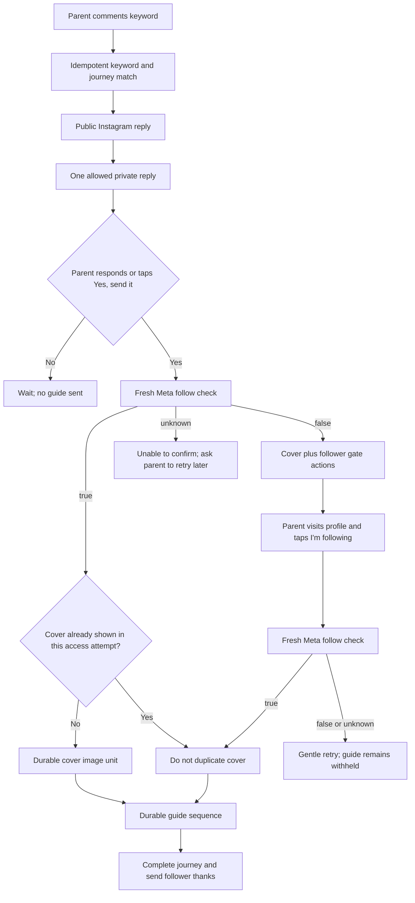
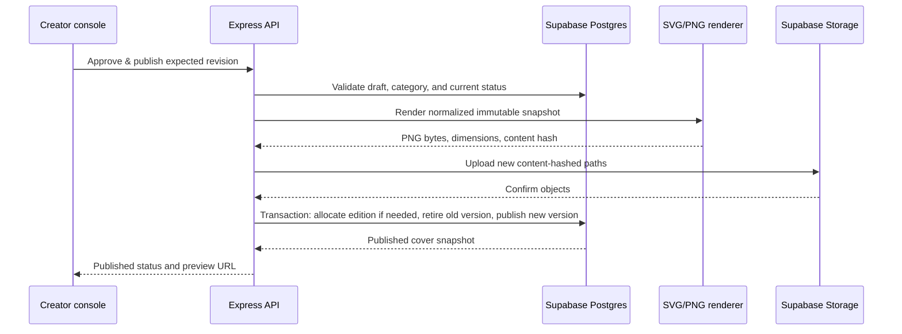

# TinySoho Reusable Guide Covers and Follower-Gated Instagram Delivery Design

**Status:** Approved visual directions consolidated; technical design ready for owner review

**Date:** 2026-08-22

**Implementation status:** Not started

**Production base audited:** `origin/main` at `1c8ff0106a302de9b83b351bc44184f397933e59`

## Executive decision

TinySoho will add a reusable, category-led guide-cover system to the existing
Instagram comment-to-DM automation. Every published guide may have one premium,
versioned cover generated from a deterministic TinySoho template. The cover is
shown as part of the parent journey and is never generated separately for each
parent.

The parent journey will also become a strict follower-gated flow:

1. A parent comments the configured keyword.
2. TinySoho sends the existing public acknowledgement.
3. TinySoho sends one neutral private reply asking the parent to request the
   guide with one tap when Meta supports that control.
4. Only after that inbound action does the backend read a fresh follow status
   from Meta.
5. A confirmed follower receives the guide. A confirmed non-follower receives
   the cover, a profile action, and an **I'm following ✓** action.
6. Every **I'm following ✓** action causes another fresh Meta follow check. The
   guide is delivered only when Meta returns `true`.

The visual system and AI assistance are separate concerns. Templates, palettes,
illustrations, spacing, typography, and rendering are deterministic application
code. AI may suggest bounded category and copy fields, but a creator must review
and approve the result. AI failure can never prevent manual cover authoring or
ordinary guide publishing.

## Supersession and source of truth

This document is the source of truth for the reusable cover system and the
follower-gated parent flow.

It intentionally supersedes the statements in
`docs/feature-requests/2026-08-21-interactive-instagram-parent-and-creator-experience.html`
that say guide access is not conditional on following and that unknown follow
status may receive the guide. The owner subsequently made a clear product
decision: **the guide is sent only after Meta confirms that the person follows
@tinysoho**.

The older document remains useful for its broader creator-console and parent
experience ideas. Its non-gated delivery rule must not be copied into this
feature.

## Goals

- Make each guide feel like a considered TinySoho publication rather than a loose
  sequence of files and messages.
- Preserve the four approved visual directions inside one reusable design
  system.
- Keep the content creator's required work small and understandable.
- Let the creator add a new presentation category without storing an unreliable
  free-text label on every guide.
- Generate guide-specific copy suggestions from existing guide information while
  keeping all final content human-approved.
- Render each approved cover once per published version, store it in Supabase,
  and reuse its immutable public URL.
- Replace manual `DONE` typing with native actions where Meta supports them, with
  a truthful text fallback where it does not.
- Require a fresh positive follow check before every new or repeated guide
  delivery.
- Extend the existing durable delivery ledger so a cover cannot create duplicate
  or partially invisible sends.
- Roll out without disrupting the existing production automation.

## Non-goals

- Building a freeform Canva-style design editor.
- Letting a model invent arbitrary palettes, typography, layouts, or images.
- Generating a unique image for every parent or personalizing a cover with parent
  or child data.
- Requiring a real photograph for recipes in V1.
- Automatically publishing model-generated copy.
- Proactively discovering all @tinysoho followers or DMing people who have not
  entered a valid Instagram messaging context.
- Changing Instagram's native button colors, DM typography, bubble shape, or
  conversation chrome.
- Replacing the existing guide step editor, durable guide delivery ledger, or
  resource-message format.
- Solving the complete journey-builder and console redesign described in the
  broader 2026-08-21 feature request.

## Production reality

### Current resource and creator model

Production currently stores `Resource.name`, `Resource.description`, `kind`, a
coarse `theme`, age limits, and ordered text/image/PDF messages.

`Resource.theme` is a routing facet with values such as `sleep`, `eating`,
`behavior`, and `learning`. It is not a visual-presentation category:

- it does not distinguish recipes from feeding advice;
- it does not represent potty training cleanly;
- it does not distinguish Montessori-inspired activities from all learning
  resources;
- many existing resources have no value;
- changing its meaning would risk the recommendation and routing code that
  already reads it.

The new presentation category must therefore be a separate relation. The old
`theme` field remains intact.

The current sequence editor lets the creator edit name, an internal description,
and ordered message steps. It saves most fields on blur and labels the preview
**After DONE reply**. It has no category field, cover data, approval state, or
whole-flow preview.

The audited Supabase inventory contains 70 resources. Of the 57 active
resources, 26 are classified and 31 are unclassified under the existing coarse
facets. Across all resources, 43 are unclassified. These rows must be reviewed
and backfilled; a migration must not silently guess and publish their covers.

### Current parent flow

The production comment path currently:

1. matches the comment against an active keyword;
2. opens or reuses a canonical journey;
3. sends the configured public reply;
4. reads cached follow state only to choose opening private-reply wording;
5. sends one text-only private reply addressed by `comment_id`;
6. waits for an inbound DM;
7. calls `resolveUsername`, which fetches a fresh
   `is_user_follow_business` value from Meta;
8. delivers to confirmed followers, asks confirmed non-followers to follow, and
   currently lets a rare `null` follow result fall through to delivery.

The existing hard-gate text still asks the person to reply `DONE`. Any actual
reply to an open gate is accepted, but the UI gives the parent no native action.
The `postbackHandler` records recovery evidence and does not yet route an action
to guide delivery.

The durable delivery ledger already compiles resource steps into text, image, and
file units, snapshots their content, checkpoints each send, resumes definitive
failures, and refuses to auto-retry uncertain provider outcomes. This feature
must extend that ledger rather than build a second guide sender.

### Current Meta boundary

Meta's current official private-reply documentation describes one private reply
per comment, sent within seven days, with a text `message` addressed by
`comment_id`. Follow-up messages are allowed only after the recipient responds
and inside the resulting messaging window.

Meta separately documents:

- quick replies, where tapping a preset response produces a normal inbound
  message webhook with an optional payload;
- generic templates containing an image, text, and buttons;
- postback webhooks for button actions.

The screenshots that inspired this work demonstrate an initial private reply
with a button, but TinySoho's production sender and Meta's official private-reply
example are text-only. The initial one-tap control is therefore conditional on a
live capability spike using TinySoho's exact login type, permissions, Graph API
version, and test account. No implementation may assume that a generic or quick
reply payload is valid in the one allowed comment-private-reply slot until that
test succeeds.

## Approved visual system

### Brand-wide rules

All categories share one premium editorial family:

- a warm editorial serif for the guide headline and closing line;
- a restrained sans serif for labels and supporting copy;
- generous negative space and consistent hierarchy;
- a wide rounded card with an approved aspect ratio of approximately `1.31:1`;
- a small uppercase kicker at the upper left;
- a collection label and edition number at the upper right;
- a two-line maximum headline;
- one concise supporting line;
- one closing line in the lower left;
- category-specific vector artwork in a fixed corner or right-side region;
- no stock-photo look, heavy gradients, neon treatment, glossy 3D objects, or
  arbitrary AI illustration styles.

The prototype used Georgia as a convenient editorial serif. Production must not
depend on fonts installed on a developer laptop or Railway host. The renderer
will bundle versioned, license-cleared font files. The first implementation
candidate is Source Serif 4 for editorial text and Inter for labels/body copy;
snapshot approval must confirm that the result retains the approved character
before parent delivery is enabled.

### Static, category-owned, and guide-owned fields

| Layer | Owner | Fields |
| --- | --- | --- |
| Brand-wide | Application code | Canvas, grid, type scale, spacing, radii, safe areas, renderer version, overflow rules |
| Category-owned | Presentation category | Default kicker, collection label, palette key, template key, illustration family/key |
| Guide-owned | Cover version | Headline, supporting line, closing line, alternative description |
| Backend-owned | Publication transaction | Edition number, revision, content hash, render paths, timestamps |
| Creator-owned | Human decision | Category confirmation, edits to guide-owned copy, final approval/publish action |

In V1, the kicker remains consistent across its category. It differs between
Bedtime, Potty Training, Recipes, and Montessori-inspired Activities, but not
between individual guides inside the same category. The collection label is
also category-owned. Neither field is model-invented. The edition number is
never entered manually.

### Approved direction 1: Bedtime — Warm editorial

| Property | Approved value |
| --- | --- |
| Category slug | `bedtime` |
| Default kicker | `A TINY WIN FOR TONIGHT` |
| Collection label | `SLEEP` |
| Template key | `warm_editorial_corner_v1` |
| Palette key | `bedtime_blush_v1` |
| Illustration key | `bedtime_window_house_v1` |
| Palette | Blush `#F5DFDA`, cream `#FBF4E6`, lavender `#C9BFD8`, sage `#B9C3A4`, berry `#6A3446`, soft coral `#E58C7D` |
| Illustration | Moonlit house/window vignette with gentle hills and small stars |
| Example headline | `Bedtime can feel softer` |
| Example support | `A calmer bedtime, one small shift at a time.` |
| Example closing | `Prepared for calmer evenings.` |

### Approved direction 2: Potty Training — Sunlit ritual

| Property | Approved value |
| --- | --- |
| Category slug | `potty-training` |
| Default kicker | `A LITTLE STEP FOR TODAY` |
| Collection label | `POTTY` |
| Template key | `warm_editorial_corner_v1` |
| Palette key | `potty_sunlit_v1` |
| Illustration key | `potty_sunlit_ritual_v1` |
| Palette | Warm blush `#F3E5DC`, apricot `#E0B49C`, sage `#B5C1A8`, lavender-grey `#D4C9D8`, brown `#604139`, cream `#FFF8EE` |
| Illustration | Calm arched light, folded towel, plant, and progress cues |
| Explicit exclusion | No toilet, potty, stool, underwear, bodily-fluid, or clinical imagery |
| Example headline | `Ready in their own time` |
| Example support | `Simple routines for growing confidence, without pressure.` |
| Example closing | `Prepared for little moments of progress.` |

### Approved direction 3: Recipes — Corner table

| Property | Approved value |
| --- | --- |
| Category slug | `recipes` |
| Default kicker | `A LITTLE WIN AT THE TABLE` |
| Collection label | `RECIPES` |
| Template key | `warm_editorial_corner_v1` |
| Palette key | `recipes_corner_table_v1` |
| Illustration key | `recipes_corner_bowl_v1` |
| Palette | Butter `#F5E4B6`, apricot `#DF9173`, sage `#AEB995`, cream `#F7EFE4`, berry `#663B45`, lavender accent `#C9BFD8` |
| Illustration | Illustrated bowl/plate and utensil arranged in the lower-right corner |
| V1 photograph rule | No photograph is required; the approved illustrated system is the default |
| Example headline | `Something lovely for lunch` |
| Example support | `Simple, nourishing food for busy family days.` |
| Example closing | `Made with care by TinySoho.` |

A real creator photograph may become an optional future template only when the
specific finished dish materially improves trust or clarity. It is not needed
for this implementation and must not be added as a mandatory creator field.

### Approved direction 4: Montessori-inspired Activities — Discovery tray

| Property | Approved value |
| --- | --- |
| Category slug | `montessori-activities` |
| Default kicker | `PURPOSEFUL PLAY FOR TODAY` |
| Collection label | `LEARNING` |
| Template key | `editorial_right_panel_v1` |
| Palette key | `montessori_discovery_v1` |
| Illustration key | `discovery_tray_right_v1` |
| Palette | Blush `#F1E5DC`, natural wood `#D7AA7F`, sage `#AEBD9F`, lavender `#C9BED8`, berry `#5A3C4D`, cream `#FFF8EE` |
| Illustration | Montessori-inspired discovery tray, geometric learning objects, and a structured right-side panel |
| Composition | Artwork remains on the right side, not along the bottom |
| Example headline | `Little hands, growing minds` |
| Example support | `A calm invitation to focus, coordinate and discover.` |
| Example closing | `Prepared for curious little minds.` |

The name “Montessori-inspired” is a presentation category, not a claim that each
resource is certified Montessori material. A creator must choose it only where
the activity actually reflects purposeful, child-led, hands-on discovery.

### Geometry and overflow contract

The canonical DM cover is rendered at `1200 × 916` pixels, preserving the
approved `1.31:1` composition. The renderer uses proportions rather than
device-dependent CSS:

- top labels begin at 7.5% from the top and 7% from each side;
- the headline begins around 21% from the top;
- the supporting line begins around 51%;
- the closing line ends around 9% from the bottom;
- corner-scene categories reserve the lower-right 43% width and 58% height;
- the Montessori template reserves a full-height right panel of about 33%;
- text in the Montessori template stays within the left 58%;
- no copy may enter the artwork safe area;
- visible card corners use a radius equivalent to 22 CSS pixels in the approved
  prototype.

Validated content limits are deliberately tighter than the database's general
description field:

| Field | Limit | Render rule |
| --- | ---: | --- |
| Kicker | 32 characters | Uppercase, one line |
| Collection label | 16 characters | Uppercase, one line |
| Headline | 56 characters | Maximum two lines |
| Supporting line | 90 characters | Maximum two lines |
| Closing line | 64 characters | Maximum two lines |
| Alternative description | 240 characters | Console/accessibility metadata; not rendered |

The shared renderer measures the bundled fonts before publishing. It never
shrinks type below the approved minimum merely to fit excess copy. Overflow
returns `cover_text_overflow` and blocks publish until the creator edits the
field. Browser preview and server PNG generation must call the same pure layout
and text-measurement policy.

## Creator console experience

### Required creator input

The content creator supplies only information that represents editorial truth:

1. **Guide name** — already required.
2. **What this guide helps with** — the existing internal description, relabeled
   and prompted clearly enough to support good copy suggestions.
3. **Presentation category** — chosen or confirmed from a searchable dropdown.
4. **Final cover approval** — after reviewing and optionally editing the
   suggestion in the exact cover preview.

The creator is not asked to choose hex colors, fonts, dimensions, margins,
illustration positions, edition numbers, storage paths, image formats, or model
settings.

### Presentation and cover panel

Add a **Presentation & cover** panel between the guide identity fields and the
existing Steps editor.

The panel contains:

- a searchable **Presentation category** combobox;
- an **Add category** action inside the combobox;
- category status: `Ready`, `Needs visual review`, or `Inactive`;
- read-only category kicker/collection context plus editable headline,
  supporting line, and closing line fields;
- live character and line-fit feedback;
- **Suggest from guide** when AI suggestions are enabled;
- **Reset to category defaults** for the category-owned fields;
- the exact cover preview, not a generic placeholder;
- status states: `Not configured`, `Draft`, `Needs attention`, `Approved`,
  `Publishing`, `Published`, and `Publish failed`;
- explicit **Save cover draft** and **Approve & publish** actions.

Cover editing must not rely on blur-save. The creator needs an obvious boundary
between a local/editable draft and the immutable image parents will receive.
Saving a cover draft never changes the currently published cover.

The existing Steps editor may continue its present save behavior during V1. This
feature does not need to solve the broader guide-versioning project first.

### Adding a category

The combobox supports **Add category** without storing a one-off free-text value
on the resource.

1. The creator enters a human name such as `Feeding`.
2. The server normalizes and reserves a stable lowercase slug.
3. The UI proposes a short collection label and the closest bounded TinySoho
   visual family.
4. The creator confirms the label and one available template/palette/illustration
   combination.
5. The category is saved as a reusable database row.

If the category has not received a valid visual combination, it is saved with
`design_status = needs_review`. Guides may be assigned to it and saved, but a
cover cannot be published. This lets a creator capture the correct taxonomy
without accidentally publishing an off-brand default.

Category names and slugs are unique case-insensitively. Categories are
deactivated instead of deleted after use. Deactivation prevents new assignment
but does not alter existing published covers.

### AI-assisted suggestion flow

The existing repository already has a server-side Gemini integration for
analysis/classification. The separate Codex runtime is designed for advisor and
owner-approved DM drafting; it is not configured as a reliable cover-publishing
dependency.

V1 therefore defines a provider-neutral `PresentationSuggestionProvider` and
initially implements it with the existing server-side Gemini boundary.

The model receives only:

- resource name;
- internal purpose/description;
- selected category or a bounded list of category candidates;
- a small bounded excerpt of existing resource-step text/alternative text when
  needed;
- the allowed copy schema.

It receives no parent identity, DM history, follower data, access token, or
Supabase credential.

The model returns strict structured data:

```json
{
  "categorySlug": "bedtime",
  "headline": "Bedtime can feel softer",
  "supportingLine": "A calmer bedtime, one small shift at a time.",
  "closingLine": "Prepared for calmer evenings.",
  "alternativeDescription": "Blush TinySoho sleep guide cover with a moonlit house illustration.",
  "confidence": "high",
  "warnings": []
}
```

The server validates this response with Zod, rejects unknown categories, applies
the exact text limits, takes the visual keys only from the selected category,
and stores the immutable suggestion separately from the creator's editable cover
draft.

AI does not return CSS, SVG, colors, font names, coordinates, URLs, HTML, or
arbitrary image prompts. It cannot publish. If it is disabled, over budget,
times out, or returns invalid data, the creator sees the deterministic category
defaults and editable name-based copy instead.

“Rewrite in TinySoho voice” may later use Codex as an optional suggestion
provider, but Codex authentication or quota must never become a prerequisite for
publishing a guide.

### Existing-resource backfill

Backfill is a review workflow, not a blind migration:

1. Add the new schema with every existing resource unassigned.
2. Apply high-confidence deterministic suggestions first, such as an existing
   recipe `kind` suggesting Recipes or a clear sleep title suggesting Bedtime.
3. Use Gemini only to suggest among the bounded categories for ambiguous rows.
4. Present active resources in a bulk review queue showing name, description,
   existing coarse facets, proposed category, confidence, and warnings.
5. Require creator confirmation before a category assignment becomes ready for
   cover authoring.
6. Render and approve covers individually or in an explicitly reviewed batch.
7. Do not enable parent delivery for a resource without a published cover until
   that resource has been reviewed.

Inactive and orphan draft resources may be backfilled after the 57 active rows.

## Parent Instagram experience

### Selected copy

The neutral opening copy is the same for followers and non-followers because the
comment webhook does not provide a fresh authoritative follow result:

> Got it 💛 I've got the {guide name} you asked for. Want me to send it here?

Preferred action:

> **Yes, send it**

The approved non-follower gate copy is:

> Your {guide name} is waiting ✨
>
> Follow @tinysoho for more ideas like this, then tap I'm following and I'll send
> it over.

Actions:

- **Visit profile** — URL action to `https://www.instagram.com/tinysoho/`
- **I'm following ✓** — postback or quick-reply action tied to the current
  access attempt

The copy remains dynamic only where braces appear. Button labels fit Meta's
documented limits and are stored as reviewed application constants rather than
generated for every guide.

### Comment-triggered flow



Detailed behavior:

1. Comment matching, comment claiming, canonical journey resolution, and public
   acknowledgement retain their current idempotency rules.
2. The opening private reply is sent once per journey. It makes no claim about
   follow status.
3. If the initial one-tap payload passes the capability spike, its action is
   **Yes, send it**. Tapping it must produce a normal action/inbound webhook that
   opens the valid standard messaging window.
4. If the rich private-reply payload is unsupported, send the same copy as text.
   The fallback asks for a short `YES`, but the router accepts any genuine reply
   to the current access attempt. `DONE` is not required.
5. After that inbound, call the live-only verifier defined below and use its
   fresh `is_user_follow_business` result. Do not authorize from
   `resolveUsername`, `getFollowState`, or a historical `IgUser.isFollower`
   value.
6. `true` is the only automated-delivery authorization.
7. `false` sends the approved cover and follower gate.
8. `null`, a Meta error, consent error, or unreadable profile sends no guide. It
   records `follow_check_unavailable` and gives the parent a retry path without
   falsely saying they do or do not follow.
9. Tapping **I'm following ✓** consumes one idempotent action token and performs
   another fresh Meta lookup.
10. If Meta still returns `false`, send at most two gentle retry responses for
    that access attempt. Each response contains a new action token so a replay of
    an older postback cannot start two deliveries.
11. After the bounded automatic responses are used, leave the attempt open and
    mark it for owner review. Do not spam the parent or relax the gate.
12. Once follow status is `true`, deliver the existing guide messages through
    the durable guide-delivery service.

Suggested retry copy, subject to final copy review before implementation:

> Almost there 💛 Instagram may take a moment to update. Check that you're
> following @tinysoho, wait a little, then tap I'm following once more.

This copy is operational fallback, not one of the previously approved campaign
messages. It must remain editable as a reviewed application constant.

### Follower path

A person who followed @tinysoho two months ago but has never used the automation
still receives the neutral opening. After they tap **Yes, send it**, the fresh
Meta check returns `true`, so the cover and guide are delivered directly. No
follow request is shown.

A stale cached `true` never bypasses the fresh check. A stale cached `false`
never causes a real follower to see the gate after the fresh check succeeds.

### Live-only follow verification contract

The current `resolveUsername` always attempts a Graph request, but its error path
may load and return an existing `IgUser` row. That older row is useful for a
display name; it is not proof that Meta confirmed the follow state for the
current action.

Introduce a dedicated authorization boundary such as
`resolveFollowStatusFresh(igUserId)` returning a discriminated result:

```ts
type FreshFollowResult =
  | { source: "meta_live"; isFollower: boolean; checkedAt: Date }
  | { source: "unavailable"; isFollower: null; checkedAt: Date; errorCode: string };
```

It must always attempt the Meta profile read. On success, it may update the
cached `IgUser` fields and return `meta_live`. On any Graph, consent, transport,
parse, or database-write error, authorization receives `unavailable` and `null`.
It must never substitute the cached Boolean.

Automated delivery requires both `source = meta_live` and
`isFollower = true` from the current action. `resolveUsername` may continue to
serve username/display metadata, but it is not an authorization function for
this feature.

### Non-follower path

After **Yes, send it**, a fresh `false` causes TinySoho to send:

1. the approved category cover;
2. the approved non-follower copy as native text;
3. **Visit profile** and **I'm following ✓** actions.

The cover is recorded as shown for this access attempt. When the later follow
check succeeds, the guide sequence begins without repeating the same cover.

### Unknown follow status

The current production code delivers when the fresh flag is exceptionally
`null`. That behavior must change for this strict-gate feature.

Unknown means “TinySoho cannot verify,” not “non-follower.” The parent receives
neutral retry wording, the guide remains withheld, and the owner can inspect the
attempt. The system must never claim the person is not following when Meta did
not say so.

### Direct-DM keyword path

When a parent sends a keyword directly by DM, the inbound message has already
opened the messaging context. Do not send the **Yes, send it** opening again.

- fresh `true` → send cover and guide;
- fresh `false` → send cover and follower gate;
- unknown → withhold and offer a retry;
- completed guide requested again → run the same fresh follower gate before
  redelivery.

Existing behavior that redelivers a completed guide regardless of current follow
state is intentionally replaced. Every new automated guide send, including an
explicit redelivery, requires a current `true`.

### People outside the automation

The system cannot use this feature to enumerate all Instagram followers and send
them unsolicited DMs. There is no reliable public “give me every follower and
message them” path in the current architecture, and the standard messaging
window still applies.

Someone who followed outside the automation becomes reachable when they enter a
supported context, such as commenting the keyword or sending a DM. At that point
the system can read current follow status in the messaging context and continue
the appropriate flow.

### Rich-message fallback matrix

| Moment | Preferred | Fallback | Invariant |
| --- | --- | --- | --- |
| Initial comment private reply | Quick reply or supported native action: **Yes, send it** | Text-only private reply; accept the next genuine inbound reply | Only one comment private reply |
| Confirmed non-follower gate | Generic template with cover, native text, profile URL, and postback | Cover image message, then text plus quick reply; include profile URL in text if URL button is unavailable | Cover and copy remain accessible |
| Follow recheck | **I'm following ✓** postback | Quick reply with the same label or a normal inbound reply | Every action performs a fresh check |
| Unsupported desktop control | Plain text instructions | Same | Parent is not trapped by a mobile-only control |
| No published cover | Existing text gate and guide flow under strict follow verification | Same | Missing presentation never relaxes the gate |

Instagram controls how native controls look. TinySoho must not simulate a button
inside a raster image and imply that the image itself is interactive.

## Cover exposure and durable delivery

### Access-attempt state

Button routing requires a durable state that the current recovery-only postback
handler does not provide. Add a `GuideAccessAttempt` for one parent request:

- `id` UUID;
- `conversation_id` UUID foreign key;
- `resource_id` UUID foreign key;
- snapshotted `cover_version_id`, nullable when none is published;
- state: `awaiting_request`, `checking_follow`, `awaiting_follow`, `delivering`,
  `delivered`, `needs_review`, or `expired`;
- last follow result: `follower`, `non_follower`, or `unknown`;
- last follow-check time and bounded check/response counts;
- cover exposure state: `not_shown`, `accepted`, `uncertain`, or `failed`;
- cover provider message ID when known;
- messaging-window expiry;
- created and updated timestamps.

One active attempt is allowed per conversation. A repeated webhook loads the
same attempt rather than creating a second parent journey.

Add short-lived `GuideActionToken` rows for `request_guide` and `check_follow`.
The token UUID is the only identifier placed in a quick-reply/postback payload.
The server validates that the sender matches the attempt, the token is active,
the attempt is in a compatible state, and the token has not expired. Consuming a
token and claiming the state transition happen atomically. A replay is an
idempotent no-op.

Postbacks must move from the recovery-only handler into a small action router.
The router records recovery evidence as it does today, then routes only known,
validated guide payloads. Unknown payloads remain acknowledged and fail closed.

### Guide delivery extension

Extend `GuideDeliveryUnitOrigin` with `generated_cover`.

When a confirmed follower has not already seen the current cover during the
access attempt, the guide planner prepends one image unit:

- `origin = generated_cover`;
- `resource_message_id = null`;
- `kind = image`;
- `media_url_snapshot` is the immutable published cover URL;
- the ordinary content fingerprint protects the snapshot.

The existing resource steps follow without modification. Cover and guide are
therefore covered by the same claim lease, provider checkpoint, retry policy,
and uncertain-send review behavior.

When a non-follower already saw the cover in the gate, the planner does not add
the cover again after successful verification. An `uncertain` cover exposure is
never automatically repeated; the attempt goes to review because Meta may have
accepted it.

## Rendering and storage architecture

### Deterministic renderer

Implement the cover as code-native SVG, not a model-generated bitmap:

1. A shared pure TypeScript module accepts a validated `GuideCoverRenderInput`.
2. It selects only registered template, palette, and illustration keys.
3. It lays out SVG using the approved geometry and bundled fonts.
4. Browser preview displays that same SVG output.
5. On publish, the server renders the SVG to PNG using a pinned deterministic
   renderer such as `@resvg/resvg-js`.
6. Visual snapshot tests cover each approved category, long-but-valid text,
   edition numbers above 99, and every overflow boundary.

The render content hash includes normalized copy, category/edition, template,
palette, illustration, canvas/rendition, renderer version, and font asset
versions. Identical input produces the same hash and immutable path.

### Renditions

V1 produces two renditions from the same source layout:

- `dm_cover`: canonical `1200 × 916` image used as an ordinary Instagram image
  message;
- `generic_card`: a safe-area-aware derivative enabled only after the Meta
  capability spike confirms current generic-template presentation and crop
  behavior.

The generic derivative is recomposed from the same primitives, not blindly
cropped. If the capability spike cannot prove a reliable result, only
`dm_cover` is published and the generic-template feature flag stays off.

### Supabase Storage

The existing `insta-resources` bucket is public. Supabase documents that public
bucket retrieval bypasses access controls for anyone who possesses the URL,
while upload/delete operations remain protected. Published Instagram cover
assets are intentionally public because Meta must retrieve them.

Draft cover previews must not be uploaded to that public bucket. V1 previews
render locally from the shared SVG module. If server-rendered drafts are added
later, they must use a private bucket and short-lived signed read URLs.

Published paths are server-owned and immutable:

```text
guide-cover/{resource_id}/{cover_version_id}/{content_hash}/dm.png
guide-cover/{resource_id}/{cover_version_id}/{content_hash}/generic.png
```

The server uploads generated assets with the server-held Supabase service key.
It does not expose this path through the creator-facing `/upload/sign` route.
Browser code never receives the service key.

Each new cover version uses a new content-hashed path. Do not overwrite an
existing public object; Supabase recommends a new path for updated cached assets.
Set a long immutable cache-control value on upload because that path will never
be reused for different content.

If storage succeeds but the database transaction fails, record an orphan-cleanup
task keyed by the content hash. Never reuse an ambiguous path for different
content.

### Accessibility

Meta media sending does not provide this architecture with a dependable custom
alt-text field. Therefore no required instruction or follow condition may exist
only inside the image.

- Generic-template title, subtitle, and buttons remain native text.
- The fallback sends the approved gate as a separate text message.
- The guide name and action are repeated in text even when the cover is visible.
- The creator stores and reviews an alternative description for the console,
  future surfaces, and audit.
- Render tests enforce minimum type sizes and palette contrast.
- Decorative illustration details are not necessary to understand how to get
  the guide.

## Data model

The following names match existing Prisma conventions. The SQL migration may use
hand-authored constraints and partial indexes that Prisma cannot express.

### `PresentationCategory`

Reusable row for a creator-selectable presentation category:

- `id` UUID primary key;
- `slug` lowercase unique text;
- `name` case-insensitive unique display name;
- `collection_label` text;
- `default_kicker` text;
- `template_key`, `palette_key`, and `illustration_key` text validated against
  the code registry;
- `design_status`: `ready`, `needs_review`, or `inactive`;
- `next_edition_number` positive integer, default `1`;
- optional sort order;
- created/updated timestamps and owner audit identity.

Foreign keys that reference a category use `ON DELETE RESTRICT`. A used category
is deactivated, not deleted.

### `ResourcePresentation`

One optional presentation identity per resource:

- `resource_id` UUID primary/foreign key to `Resource`, `ON DELETE RESTRICT`;
- `category_id` UUID foreign key, indexed;
- `edition_number` nullable positive integer;
- created and updated timestamps.

`(category_id, edition_number)` is unique when an edition exists. The number is
allocated only on first publication and remains stable across cover revisions.

Allocation is concurrency-safe: inside the publish transaction, atomically
increment `PresentationCategory.next_edition_number` with `UPDATE ... RETURNING`
and copy the returned prior value into the resource presentation. A unique
constraint is the final backstop.

Changing category after first publication is an explicit **Move collection**
operation. It retires the old published cover, allocates a new edition in the
target category, and preserves the old category/edition snapshot on historical
cover versions. A normal edit cannot silently renumber a guide.

Resource deletion must also become presentation-aware. A resource with a
published cover returns `resource_has_published_cover` until the owner explicitly
retires it. An unpublished presentation can be removed through a bounded cleanup
that deletes its draft rows before the resource. Storage cleanup is recorded and
retryable; no broad bucket prefix is ever recursively deleted.

### `ResourceCoverSuggestion`

Immutable model suggestion:

- IDs for resource and suggested category;
- suggested headline, supporting line, closing line, and alternative
  description;
- confidence and bounded warnings;
- provider, model, prompt version, and normalized source hash;
- created timestamp.

The raw model prompt, secrets, parent data, and arbitrary chain-of-thought are
not stored.

### `ResourceCoverVersion`

Versioned, creator-reviewed publication:

- `id` UUID primary key;
- `resource_id` UUID and monotonic `revision`;
- status: `draft`, `approved`, `published`, or `retired`;
- render status: `not_rendered`, `rendering`, `ready`, or `failed`;
- snapshot category ID and nullable edition number;
- snapshot template, palette, and illustration keys;
- working kicker, headline, supporting line, closing line, and alternative
  description;
- nullable `suggestion_id` linking the original immutable suggestion;
- content hash, `dm_storage_path`, and nullable `generic_storage_path`;
- allowlisted render error code, never raw prompt/output or a secret-bearing
  exception;
- approved/published identity and timestamps;
- created/updated timestamps.

Constraints and indexes:

- unique `(resource_id, revision)`;
- partial unique index allowing only one `published` version per resource;
- indexes on every foreign key;
- non-empty and length checks matching the shared cover policy;
- published rows require `render_status = ready`, an edition number, content
  hash, and DM storage path;
- draft/approved rows cannot be read through an unauthenticated browser API.

### `GuideAccessAttempt` and `GuideActionToken`

Use the access-attempt fields described in the parent-flow section. Add indexes
for active attempts by conversation, expiring attempts, and action tokens by
attempt/status. Foreign-key indexes are mandatory.

The token table stores only opaque IDs and lifecycle state. It does not store
access tokens or parent message bodies.

### RLS and privileges

These tables are server-owned. Browser requests go through the authenticated
Express API.

- Enable RLS on new application tables if they are exposed through Supabase's
  API schemas.
- Grant no direct `anon` or general `authenticated` write policy.
- Use least-privilege server/database roles in deployment.
- Keep the Supabase service key exclusively on the server; Supabase service keys
  bypass Storage RLS and must never enter the Vite bundle.
- Public access is limited to immutable published PNG objects, not database rows
  or drafts.

## API contracts

### Creator endpoints

Recommended endpoints:

```text
GET    /api/presentation-categories
POST   /api/presentation-categories
PATCH  /api/presentation-categories/:id

GET    /api/resources/:id/presentation
PUT    /api/resources/:id/presentation
POST   /api/resources/:id/cover-suggestions
POST   /api/resources/:id/cover-versions
PATCH  /api/cover-versions/:id
POST   /api/cover-versions/:id/approve
POST   /api/cover-versions/:id/publish
```

Every create uses the repository's existing client-generated UUID and
idempotency-key pattern. Publish requires the expected revision/status so two
browser tabs cannot publish conflicting edits.

Stable error codes include:

- `presentation_category_not_ready`;
- `presentation_category_duplicate`;
- `cover_text_overflow`;
- `cover_invalid_visual_key`;
- `cover_render_failed`;
- `cover_publish_conflict`;
- `cover_not_approved`;
- `published_cover_immutable`.

The API returns bucket-relative storage paths and safe public published URLs. It
never returns a Supabase service credential or raw renderer exception.

### Parent action routing

Outbound payloads contain only an opaque action token, for example:

```text
ts:guide:3f05a514-1f04-4b14-9df4-7730c7c39af4
```

The handler does not trust a payload's claimed action, resource, conversation,
or recipient. It loads those values from the token row and validates the webhook
sender.

Quick replies enter through the existing message handler. Postbacks enter through
the postback handler, which calls the same action service. Both paths produce one
state transition and one fresh follow check. A normal inbound action uses the
existing `inbound_reply` delivery trigger with the internal inbound-message UUID.
A successful button-based recheck uses `follow_recovery` with the consumed action
token UUID, preserving the delivery ledger's UUID idempotency contract.

Stable parent-flow outcomes include:

- `action_consumed`;
- `action_replayed`;
- `action_expired`;
- `follow_confirmed`;
- `follow_not_confirmed`;
- `follow_check_unavailable`;
- `guide_delivery_started`;
- `guide_delivery_already_started`;
- `access_attempt_needs_review`.

## Publish transaction



Rules:

- Rendering and upload happen before the short database publication transaction.
- Repeating the same publish request reuses the same cover ID/content hash and
  proves the objects exist; it does not allocate a second edition.
- The database transaction locks or conditionally updates the expected draft and
  current presentation rows.
- Only after the transaction commits does the new cover become eligible for
  parent journeys.
- A failed new publish never removes the previously published cover.
- A resource delivery snapshots the selected published cover version at access
  attempt creation; a later creator edit does not change an in-progress parent
  request.

## Feature flags and rollout

Use distinct flags so authoring can be validated without contacting parents:

- `GUIDE_COVER_AUTHORING_ENABLED` — category, suggestions, editor, preview, and
  publishing UI;
- `GUIDE_COVER_DELIVERY_ENABLED` — prepends or displays published covers;
- `GUIDE_RICH_GATE_ENABLED` — enables generic/quick-reply payloads proven by the
  capability spike;
- `GUIDE_FOLLOW_GATE_V2_ENABLED` — switches parent actions to strict fresh-true
  authorization and new state routing.

Flags that contact parents follow the existing flag-registry safety rules and
cannot be enabled casually from a page if the registry marks them outbound.

### Phase 0: Meta capability spike

Using TinySoho's current production login type and a controlled Instagram test
account, capture request/response/webhook evidence for:

- text-only comment private reply;
- quick reply in the one allowed private-reply slot;
- generic/button template in that slot;
- quick reply after the parent responds;
- generic template with cover, profile URL, and postback after response;
- `messaging_postbacks` delivery and sender identity;
- duplicate postback behavior;
- mobile and desktop rendering;
- generic image crop/safe area;
- current follow-flag behavior immediately after following.

Record the Graph API version, login type, permissions, timestamp, sanitized
payload, response status, webhook type, and screenshot. Unsupported initial-rich
payloads are not retried in production; the text fallback remains the release
path.

### Phase 1: Hidden authoring foundation

- Add schema, constraints, indexes, category seeds, shared renderer, and APIs.
- Keep every outbound flag off.
- Snapshot-test the four approved covers.
- Confirm no service credential reaches the browser.

### Phase 2: Creator review and backfill

- Enable the authoring UI for the owner.
- Classify and review active resources.
- Publish a cover for a small representative guide in each approved category.
- Compare browser SVG preview to stored PNG output.

### Phase 3: Test-account journey

- Exercise follower, non-follower, unknown, follow-lag, postback replay,
  unsupported-client, send-failure, and uncertain-send cases.
- Inspect actual Instagram rendering, not only the console mock.
- Verify no cover or guide is duplicated.

### Phase 4: Production cohort

- Enable strict action routing for an allowlisted cohort/guide first.
- Enable ordinary image-cover delivery before rich generic templates.
- Expand only when delivery completion, follow-check availability, and duplicate
  rates remain healthy.
- Keep the old text path as an immediate flag-off fallback.

## Observability and measurement

Record aggregate-safe events for:

- opening private reply accepted/failed/uncertain;
- request action received, replayed, expired, or unsupported;
- fresh follow check result and latency;
- follower gate shown;
- profile action offered;
- follow recheck count and eventual confirmation;
- cover version selected;
- cover exposure accepted/failed/uncertain;
- cover omitted because already shown;
- guide delivery planned/completed/failed/needs review;
- creator suggestion generated/rejected/edited;
- cover render/publish outcome;
- category backfill confirmation.

Do not log guide copy, DM bodies, signed URLs, tokens, model prompts, Supabase
keys, or raw Axios errors.

Primary funnel metrics:

1. comments matched;
2. opening private replies accepted;
3. **Yes, send it** actions or fallback replies;
4. fresh followers at first check;
5. non-follower gates shown;
6. later verified follows;
7. complete guide deliveries;
8. time from comment to complete guide;
9. follow-check unknown/error rate;
10. duplicate cover and duplicate guide rate;
11. owner-review rate;
12. parent opt-out/block signals where observable.

If testing creative variants, compare two strict-gate presentations. Do not run
an ungated control that violates the approved product rule.

## Failure behavior

| Failure | Required behavior |
| --- | --- |
| AI unavailable or invalid | Show deterministic editable defaults; never block manual authoring |
| Category needs visual review | Save assignment, block cover publish with a clear action |
| Copy overflows | Keep draft visible; block approve/publish; never shrink below minimum |
| Renderer fails | Preserve prior published cover; record allowlisted error; permit retry |
| Storage upload fails | Do not publish database version |
| Storage succeeds and DB publish fails | Preserve previous version; schedule orphan cleanup; idempotent retry |
| No published cover | Use existing text/guide path while preserving strict follow verification |
| Initial rich private reply unsupported | Send one text-only private reply |
| Fresh follow is false | Show follower gate; do not deliver |
| Fresh follow is unknown/error | Neutral retry; do not deliver or falsely accuse |
| Follow flag lags | New action token and later fresh check; no automatic gate relaxation |
| Duplicate quick reply/postback | Consume token once; no duplicate cover or guide |
| Cover send outcome uncertain | Mark access attempt review; never auto-repeat cover |
| Guide unit outcome uncertain | Use existing guide-delivery review behavior |
| Messaging window closes | Expire action/delivery; require a new inbound message |

## Testing requirements

### Shared policy and renderer

- Exact palette, template, and illustration registry tests for all four approved
  categories.
- SVG/PNG visual snapshots using bundled fonts and pinned renderer version.
- Geometry tests for both corner and right-panel compositions.
- Boundary tests for every text limit, two-line fit, and overflow error.
- Three-digit edition-number layout.
- Deterministic content hash and immutable path tests.
- No unregistered visual key can reach SVG generation.
- No user text can inject SVG/HTML markup.

### Database and publish

- Case-insensitive category duplicate prevention.
- Foreign-key indexes and `ON DELETE` behavior.
- Concurrent first publish allocates exactly one edition.
- Publish replay does not allocate a new edition or overwrite a path.
- Only one published cover per resource.
- A new publish atomically retires the prior version.
- Draft and failed rows cannot satisfy published-cover lookup.
- Category move preserves historical category/edition snapshots.
- RLS/privilege tests prove browser roles cannot mutate cover tables directly.

### AI assistance

- Valid structured suggestion creates an immutable suggestion and editable draft.
- Unknown category, visual key, overflow, HTML, URL, and malformed JSON fail
  closed.
- Timeout, quota, and disabled provider return deterministic defaults.
- Creator edits do not mutate the stored original suggestion.
- No AI path can call publish.

### Creator UI

- Search/select existing category.
- Add a new reusable category and handle `needs_review` truthfully.
- Dirty/saving/saved/approved/publishing/published/failed states.
- Browser preview matches server snapshot for the same normalized input.
- Publish conflict between two tabs preserves the newer draft.
- No cover action changes resource messages unexpectedly.
- Keyboard and screen-reader labels for every form control.

### Parent flow

- Comment webhook replay creates one access attempt and one private reply.
- Cached `true` plus fresh `false` does not deliver.
- Cached `true` plus a failed/unavailable live check does not deliver.
- Cached `false` plus fresh `true` delivers directly.
- Two-month follower with no prior automation receives direct delivery after
  action and fresh check.
- Fresh `false` shows the cover/gate and does not deliver.
- Fresh `null` or error does not deliver.
- Successful later check omits a cover already shown in the gate.
- Quick reply and postback use the same action service.
- Token replay, wrong sender, wrong attempt state, and expired token fail closed.
- Direct-DM keyword follows the strict gate without the redundant opening.
- Completed-guide redelivery requires a fresh `true`.
- Generic-template-disabled and desktop fallback paths remain usable.
- Cover and guide send uncertainty never trigger an automatic duplicate.

### Live Meta verification

Automated tests are not sufficient for provider presentation. Before production
enablement, a controlled account must verify:

- the exact opening private reply;
- each supported button/action;
- the cover's real crop and resolution;
- the profile link return path;
- the postback/quick-reply webhook payload;
- follow status before and after a real follow;
- fallback behavior on desktop Instagram.

## Acceptance criteria

### Approved visual system

- Bedtime renders the approved warm-editorial moon/house direction and palette.
- Potty Training renders **Sunlit ritual** without literal potty imagery.
- Recipes renders **Corner table** with the approved illustrated bowl direction;
  no photograph is required.
- Montessori-inspired Activities renders **Discovery tray** in a structured
  right-side composition.
- All four covers visibly belong to one TinySoho system while retaining distinct
  category color and illustration identities.
- Published cover rendering is deterministic and does not call an image model.

### Creator experience

- The creator can select a reusable presentation category from a searchable
  dropdown and add a new category without creating free-text duplicates.
- The system can suggest category and guide copy from existing guide information.
- The creator can edit every guide-owned line and see an exact preview.
- The creator never has to enter colors, layout measurements, edition numbers,
  paths, or image dimensions.
- AI output never publishes without creator approval.
- Save draft and publish are explicit, separate actions.
- A failed publish leaves the previous published cover live.

### Parent experience

- A comment receives at most one allowed private reply.
- The opening makes no stale claim about follower status.
- The preferred **Yes, send it** action is used only when proved compatible; a
  text fallback always works.
- Every new guide or redelivery is authorized only by a fresh Meta `true`.
- Confirmed followers never receive the follow gate.
- Confirmed non-followers receive the approved cover, copy, profile action, and
  follow-check action.
- Unknown follow state never receives the guide and never receives a false
  “you are not following” claim.
- A successful later follow check sends the guide without duplicating a cover
  already shown.
- Unsupported rich controls do not trap the parent.

### Reliability and security

- Cover delivery uses the existing durable delivery ledger.
- Replayed webhooks/actions cannot duplicate cover or guide delivery.
- Ambiguous provider outcomes are never retried automatically.
- Draft cover assets are not placed in the public bucket.
- Published paths are immutable and content-hashed.
- The browser never receives the Supabase service key.
- Every new foreign key has an index and every server-owned table follows the
  least-privilege/RLS policy described above.

## Recommended code boundaries

The implementation plan should preserve these boundaries even if filenames are
adapted to repository conventions:

```text
shared/guideCoverPolicy.ts
shared/guideCoverRegistry.ts
shared/guideCoverRenderer.ts

src/api/presentationCategories.routes.ts
src/api/resourceCovers.routes.ts
src/services/guideCoverPublishService.ts
src/services/guideCoverSuggestionService.ts
src/services/guideAccessActionService.ts
src/services/guideAccessRepository.ts

web/src/components/guides/PresentationCategoryCombobox.tsx
web/src/components/guides/GuideCoverEditor.tsx
web/src/components/guides/GuideCoverPreview.tsx
```

The shared renderer contains no database, Storage, Meta, or AI access. The
publish service owns database/Storage orchestration. The access-action service
owns follower verification and transitions. The existing guide delivery service
remains the only owner of multi-unit guide sending.

## External references

- [Meta Instagram Private Replies](https://www.postman.com/meta/instagram/request/23987686-189d7215-22b3-403f-b2f5-a46c7e66a514)
- [Meta Instagram Quick Replies](https://www.postman.com/meta/instagram/request/23987686-df99e677-3390-449c-a016-8e94dd09ec77)
- [Meta Instagram Generic Template](https://www.postman.com/meta/instagram/documentation/6yqw8pt/instagram-api?entity=request-23987686-ab559ffb-8e2c-4b0a-b43a-5737b6d2f672)
- [Supabase Storage bucket access models](https://supabase.com/docs/guides/storage/buckets/fundamentals)
- [Supabase Storage access control](https://supabase.com/docs/guides/storage/security/access-control)
- [Supabase Smart CDN and immutable-path guidance](https://supabase.com/docs/guides/storage/cdn/smart-cdn)

## Review gate before implementation

Implementation planning begins only after the owner reviews this document and
confirms that it captures:

- the four approved visual directions;
- the selected opening and non-follower copy;
- strict fresh-`true` follower authorization, including redelivery;
- the minimal content-creator input;
- deterministic rendering and optional human-reviewed AI suggestions;
- the conditional Meta-rich-message strategy and text fallback.
